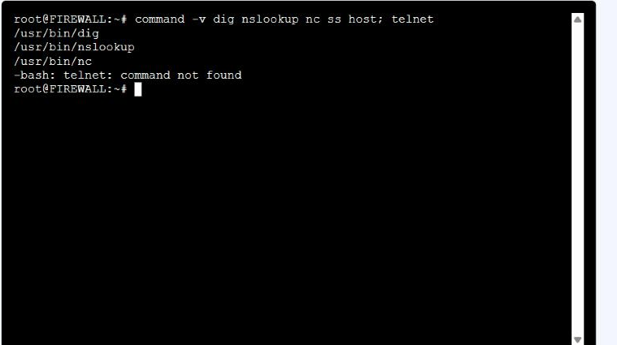
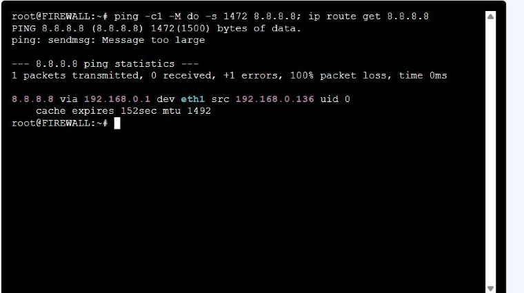
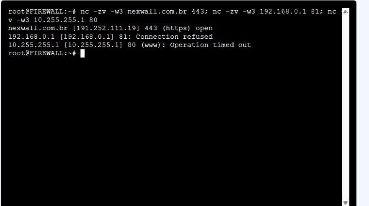
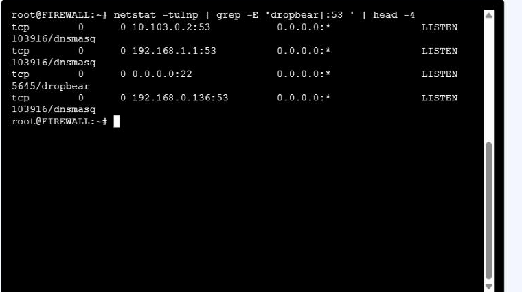

# KBA-14: Probar conectividad, puertos y tráfico desde la línea de comandos

**Síntoma.** Un usuario no alcanza un servidor, un servicio publicado no responde, o una VPN es lenta o pierde
paquetes grandes.

**Se aplica a.** Nexwall Firewall 26.2.1. Los comandos se ejecutan como `root` por SSH, por la consola o desde el
[terminal del controller](../administration/central-management.md).

## Herramientas que no están instaladas

Esta imagen es pequeña a propósito. Faltan algunas herramientas conocidas; use el sustituto.

| Falta | Use en su lugar |
|---|---|
| `telnet` | `nc -zv <host> <puerto>` para probar un puerto, o `nc <host> <puerto>` para abrir una conexión directa y conversar con él |
| `ss` | `netstat -tulnp` (puertos en escucha y el proceso de cada uno) |
| `host` | `dig` o `nslookup` (vea la [KBA de DNS](kba-15-dns-deep-dive.md)) |
| `mtr` | `traceroute -n <host>` |

Instaladas y listas: `ping` (la versión completa, con `-M do -s`), `traceroute`, `nc`, `curl`, `wget`, `openssl`,
`tcpdump`, `netstat`, `lsof`, `fuser`, `conntrack`, `arping`, `arp-scan`, `ethtool`, `bwm-ng`, `dig`, `nslookup`.

`speedtest` (SpeedTest++, una prueba de velocidad de la WAN: descarga, subida y latencia) también viene instalado. `iperf3` y `nmap` no forman parte de la imagen, y no necesita instalar nada para seguir este artículo.



*Captura: dig, nslookup y nc están instalados; telnet, ss y host no.*


## 1. Enlace y direcciones

```bash
ip -br a
ip route
```

```text
eth1       UP    192.168.0.136/24
br-lan     UP    192.168.1.1/24
tun-nsplug UNKNOWN 10.103.0.2/16

default via 192.168.0.1 dev eth1 proto static src 192.168.0.136 metric 20
192.168.1.0/24 dev br-lan proto kernel scope link src 192.168.1.1
```

Compruebe que la interfaz esté `UP` y tenga la dirección esperada, y que exista una ruta `default`. Una interfaz de
túnel como `tun-nsplug` (el enlace con el controller) muestra `UNKNOWN`, lo cual es normal en túneles.
Si sospecha del enlace físico, `ethtool <interfaz>` muestra la velocidad y si se detecta el enlace.

## 2. Alcance y camino

```bash
ping -c3 8.8.8.8
```

```text
3 packets transmitted, 3 received, 0% packet loss, time 2004ms
rtt min/avg/max/mdev = 10.256/11.931/12.869/1.187 ms
```

```bash
traceroute -n -m5 -w1 8.8.8.8
```

```text
 1  192.168.0.1  3.870 ms  3.572 ms  5.708 ms
 2  *  *  *
 3  ...
```

`* * *` en un salto es común: muchos routers no responden a las sondas. Lo importante es si responden los saltos
siguientes. Si el rastreo se detiene en el primer salto, el problema es el siguiente equipo o el enlace. Para
confirmar quién está en el segmento local use `ip neigh`, o `arping -I eth1 <ip>`.

## 3. MTU: el paquete demasiado grande

Los paquetes grandes que desaparecen mientras los pequeños pasan son el síntoma clásico de MTU, sobre todo en VPN y
enlaces PPPoE. Envíe un paquete que no debe fragmentarse:

```bash
ping -c1 -M do -s 1472 8.8.8.8
```

```text
PING 8.8.8.8 (8.8.8.8) 1472(1500) bytes of data.
ping: sendmsg: Message too large
```

`1472` más 28 bytes de cabeceras son 1500. "Message too large" aquí significa que el camino hacia ese destino permite
menos. Pregunte al núcleo qué aprendió:

```bash
ip route get 8.8.8.8
```

```text
8.8.8.8 via 192.168.0.1 dev eth1 src 192.168.0.136 uid 0
    cache expires 571sec mtu 1492
```



*Captura: un paquete de 1500 bytes que no cabe y la MTU de camino de 1492 aprendida por el núcleo.*


La MTU del camino es **1492**, típica de un enlace PPPoE. Un tamaño menor sí pasa:

```bash
ping -c1 -M do -s 1400 8.8.8.8
```

Baje el tamaño paso a paso hasta que pase; el mayor tamaño que pasa más 28 es la MTU utilizable. De igual modo, el
enlace con el controller registra el valor que le informaron: `grep Path-MTU /var/log/messages | tail -3` muestra
líneas como `EMSGSIZE Path-MTU=1420`.

## 4. ¿Está abierto el puerto? (sustituyendo a telnet)

```bash
nc -zv -w3 nexwall.com.br 443
```

```text
nexwall.com.br [191.252.111.19] 443 (https) open
```

Los tres resultados posibles indican dónde mirar:

| Resultado | Significado | Dónde mirar |
|---|---|---|
| `open` | Algo respondió | El camino de red está bien, mire la aplicación |
| `Connection refused` | El destino respondió que nada escucha | El servicio está detenido, o en otro puerto |
| `Operation timed out` | Ninguna respuesta | Una regla de firewall, una ruta ausente o un equipo caído está descartando el tráfico |

```bash
nc -zv -w3 192.168.0.1 81
nc -zv -w3 10.255.255.1 80
```

```text
192.168.0.1 [192.168.0.1] 81: Connection refused
10.255.255.1 [10.255.255.1] 80 (www): Operation timed out
```



*Captura: los tres resultados de nc -zv: open, Connection refused y Operation timed out.*


Para comprobar un servicio web de extremo a extremo, y un certificado:

```bash
curl -sI --max-time 6 https://nexwall.com.br | head -3
echo | openssl s_client -connect nexwall.com.br:443 -servername nexwall.com.br 2>/dev/null | grep -E "subject=|issuer=|Verify return|Protocol"
```

```text
HTTP/1.1 200 OK
subject=CN=nexwall.com.br
issuer=C=US, O=Let's Encrypt, CN=YE1
Protocol: TLSv1.3
Verify return code: 0 (ok)
```

## 5. ¿Qué escucha en el firewall?

```bash
netstat -tulnp
```

```text
Proto Local Address          State    PID/Program name
tcp   0.0.0.0:443            LISTEN   52552/uci.conf
tcp   0.0.0.0:22             LISTEN   5645/dropbear
tcp   192.168.1.1:53         LISTEN   103916/dnsmasq
udp   192.168.1.1:53                  103916/dnsmasq
```



*Captura: netstat -tulnp mostrando dropbear en el puerto 22 y dnsmasq en el 53.*


Úselo para confirmar que un servicio está asociado a la interfaz esperada (`127.0.0.1` significa solo local,
`0.0.0.0` significa todas las interfaces). Para ver quién ocupa un puerto, `lsof -i :443`.

## 6. Observe los paquetes

```bash
tcpdump -i eth1 -n -c 6 'udp port 53 or icmp'
```

```text
19:44:29.645520 IP 8.8.8.8 > 192.168.0.136: ICMP echo reply, id 37053, seq 1, length 64
19:44:30.003115 IP 192.168.0.136 > 1.1.1.1: ICMP echo request, id 37056, seq 1, length 24
```

Capture en el lado LAN y en el lado WAN del mismo flujo: la dirección de origen (y a menudo el puerto) debe
diferir, lo que demuestra que el NAT funciona. Añada `-w /tmp/capture.pcap` para guardar un archivo para Wireshark, y
limite siempre la captura con un filtro o `-c`, porque `/tmp` está en memoria y una captura larga la llena.

## 7. ¿Se está siguiendo la conexión?

```bash
conntrack -C
conntrack -L -d 8.8.8.8 | head -3
```

```text
381
udp 17 10 src=192.168.0.136 dst=8.8.8.8 sport=40102 dport=53 ... src=8.8.8.8 dst=192.168.0.136 sport=53 dport=40102 ...
udp 17 40 src=192.168.0.136 dst=8.8.8.8 sport=49943 dport=33440 ... [UNREPLIED] ...
```

El primer número es la cantidad de conexiones seguidas. Una entrada marcada **`[UNREPLIED]`** salió del firewall y
aún no recibió respuesta. Si todos los intentos hacia un destino quedan en `UNREPLIED`, el problema está más allá del
firewall. Si la conexión no aparece, se descartó antes del seguimiento: revise las reglas del firewall y el registro.

## Referencia rápida

| Pregunta | Comando |
|---|---|
| ¿La interfaz está activa, con qué dirección? | `ip -br a` |
| ¿Hay ruta predeterminada? | `ip route` |
| ¿Por dónde saldría el tráfico a X? | `ip route get <ip>` |
| ¿X está vivo? | `ping -c3 <ip>` |
| ¿Dónde se detiene el camino? | `traceroute -n <ip>` |
| ¿El puerto está abierto? | `nc -zv -w3 <host> <puerto>` |
| ¿Qué escucha aquí? | `netstat -tulnp` |
| ¿Cómo se ven los paquetes? | `tcpdump -i <if> -n host <ip>` |
| ¿Se sigue y se aplica NAT? | `conntrack -L -d <ip>` |
| Velocidad de la WAN (descarga, subida, latencia) | `speedtest` |

## Páginas relacionadas

- [KBA: Solucionar problemas de DNS desde la línea de comandos](kba-15-dns-deep-dive.md)
- [KBA: Verificar y solucionar problemas de servicios desde la línea de comandos](kba-16-services.md)
- [Herramientas de solución de problemas de red](network-troubleshooting-tools.md)
- [Monitoreo de conexiones](../operation-analytics/monitor-connections.md)
