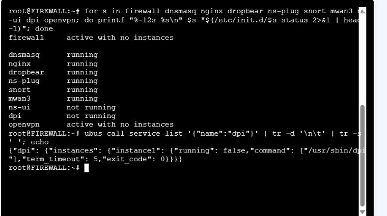

# KBA-16: Verificar y solucionar problemas de servicios desde la línea de comandos

**Síntoma.** Una función del firewall (DNS, VPN, IPS, protección web, el enlace con el controller) no se comporta
bien y la interfaz web no dice por qué.

**Se aplica a.** Nexwall Firewall 26.2.1. Los comandos se ejecutan como `root` por SSH, por la consola o desde el
[terminal del controller](../administration/central-management.md). Qué servicio respalda cada función está en la
[Referencia de comandos de servicios y registros](service-and-log-reference.md).

## 1. Pregunte al servicio por su estado

```bash
/etc/init.d/dnsmasq status
```

```text
running
```

Revise varios a la vez:

```bash
for s in firewall dnsmasq nginx dropbear ns-plug snort mwan3 ns-ui dpi openvpn; do
  printf "%-12s %s\n" $s "$(/etc/init.d/$s status 2>&1 | head -1)"
done
```

```text
firewall     active with no instances
dnsmasq      running
nginx        running
dropbear     running
ns-plug      running
snort        running
mwan3        running
ns-ui        not running
dpi          not running
openvpn      active with no instances
```

## 2. Cómo leer la respuesta

`not running` **no siempre es una falla**. La palabra depende de cómo está construido el servicio:

| Respuesta | Significado | ¿Falla? |
|---|---|---|
| `running` | Hay un proceso de larga duración activo | No |
| `active with no instances` | El servicio está habilitado pero no tiene nada que ejecutar, por ejemplo `openvpn` sin túneles configurados, o `firewall`, que solo carga reglas | No, salvo que haya configurado algo que lo necesite |
| `not running` | No hay ningún proceso activo en este momento | **Depende**: un servicio que debería estar activo está detenido (falla), o es un servicio *de una sola ejecución* que cumplió su tarea y terminó (normal) |

`ns-ui`, `dpi` y `ns-binding` son servicios de una sola ejecución en esta versión. Compruébelo pidiendo los detalles al
gestor de servicios:

```bash
ubus call service list '{"name":"dpi"}'
```

```text
{ "dpi": { "instances": { "instance1": { "running": false, "command": [ "/usr/sbin/dpi" ], "exit_code": 0 } } } }
```



*Captura: estado de diez servicios; ns-ui y dpi dicen "not running" pero terminaron con normalidad (exit_code 0).*


`"running": false` con `"exit_code": 0` significa que el programa terminó con normalidad. Una falla real muestra un
`exit_code` distinto de cero, o una instancia que se reinicia continuamente. Confirme siempre con el **efecto**: una
interfaz web que abre, o un bloqueo de DPI en el registro, dicen más que la palabra "running".

Para un servicio en ejecución, la misma llamada devuelve su `pid` y la línea de comandos exacta, que muestra qué
archivo de configuración lee:

```bash
/etc/init.d/dnsmasq info
```

## 3. ¿Está habilitado en el arranque?

```bash
/etc/init.d/dnsmasq enabled && echo yes || echo no
```

Un servicio que funciona al iniciarlo a mano y desaparece tras un reinicio no está habilitado. Use
`/etc/init.d/<servicio> enable`.

## 4. ¿Escucha y responde?

```bash
netstat -tulnp | grep -E 'dnsmasq|dropbear|nginx'
```

```text
tcp   0.0.0.0:22         LISTEN   5645/dropbear
tcp   192.168.1.1:53     LISTEN   103916/dnsmasq
```

Luego pruebe el servicio desde la red, como lo haría un cliente: `nc -zv -w3 <ip> <puerto>` o `dig @<ip> <nombre>`. Vea la
[KBA de conectividad](kba-14-connectivity.md).

## 5. Lea su registro

Todos los servicios registran en `/var/log/messages`, cada uno con su propio nombre (la columna `Find it in the log`
de la [referencia de servicios](service-and-log-reference.md)).

```bash
grep -i ns-plug /var/log/messages | tail -5
tail -f /var/log/messages | grep -i dnsmasq
```

La misma búsqueda está disponible como una sola llamada `ubus`, que es la que usa la página **Registros** de la
interfaz web:

```bash
ubus call ns.log get-log '{"search":"dropbear","limit":2}'
```

```text
{ "values": [
    "Nov 19 19:45:08 FIREWALL.lan dropbear[102974]: Child connection from 192.168.0.8:52414",
    "Nov 19 19:45:08 FIREWALL.lan dropbear[102974]: Password auth succeeded for 'root' from 192.168.0.8:52414" ] }
```

Lea las líneas **alrededor del momento de la falla**. Mensajes como `EMSGSIZE Path-MTU=1420`, `refused`,
`timed out`, `failed` y `cannot` son los primeros que hay que mirar. En esta unidad no existe `logread`; vea
[Registros y depuración](cli-logs-and-debugging.md).

## 6. Compruebe la configuración antes de reiniciar

Reiniciar con una configuración rota convierte un problema pequeño en una caída. Valide antes, donde el servicio lo
permita:

| Servicio | Comprobación |
|---|---|
| `dnsmasq` | `dnsmasq --test` imprime `syntax check OK.` |
| IPS (`snort`) | `snort-mgr check` valida la configuración generada sin aplicarla |
| Cualquier ajuste UCI | `uci show <config>` muestra lo que leerá el servicio; vea [Entender UCI](understanding-uci.md) |

## 7. Reiniciar o recargar

```bash
/etc/init.d/firewall reload     # aplica reglas sin cortar conexiones
/etc/init.d/dnsmasq restart     # breve interrupción
```

Pruebe primero `reload` donde exista. `restart` interrumpe el servicio un momento, así que en una unidad en producción
hágalo cuando sea aceptable. No reinicie `keepalived` directamente en un par de alta disponibilidad; use
`ns-ha-config`. Después repita los pasos 1 y 4 y lea de nuevo el registro.

## 8. Estado específico de cada función

Cuando las comprobaciones genéricas pasan y la función sigue fallando, la función tiene su propio comando de estado:

| Función | Comando |
|---|---|
| Enlace con el controller | `ubus call ns.plug status` |
| SD-WAN | `mwan3 status` |
| WireGuard | `wg show` |
| IPsec | `swanctl --list-sas` |
| IPS | `snort-mgr status` |
| Alta disponibilidad | `ns-ha-config status` |

```bash
ubus call ns.plug status
```

```text
{
	"status": "connected",
	"address": "10.103.0.2",
	"server": "https://cloud.nexwall.com.br",
	"unit_name": "Nexwall-LAB-FW"
}
```

## 9. La poca memoria es una causa oculta frecuente

El sistema detiene servicios cuando se agota la memoria, y las funciones de filtrado (IPS, filtrado de DNS, protección
web) son las que más consumen.

```bash
free
snort-mgr status
```

```text
              total        used        free      shared  buff/cache   available
Mem:        2009240     1254832      184416       68744      569992      612240
Total system memory=1962.148M  Used=1786.797M (91.1%)  Free=175.352M (8.9%)
```

Los valores están en kilobytes. Si `available` es muy bajo, o los servicios se reinician sin motivo aparente, busque
líneas de memoria agotada con `grep -i "out of memory\|oom" /var/log/messages | tail` y considere desactivar las
listas o funciones que no necesite. La página de filtrado de DNS indica cuánta memoria necesitan las listas activas.

## Referencia rápida

| Pregunta | Comando |
|---|---|
| ¿Está en ejecución? | `/etc/init.d/<svc> status` |
| ¿De verdad? Código de salida, pid, comando | `ubus call service list '{"name":"<svc>"}'` |
| ¿Habilitado en el arranque? | `/etc/init.d/<svc> enabled` |
| ¿Escucha? | `netstat -tulnp \| grep <svc>` |
| ¿Qué dice el registro? | `grep -i <svc> /var/log/messages \| tail -20` |
| Reiniciar | `/etc/init.d/<svc> restart` |
| Todos los servicios de esta unidad | `ls /etc/init.d` |

## Páginas relacionadas

- [KBA: Solucionar problemas de DNS desde la línea de comandos](kba-15-dns-deep-dive.md)
- [KBA: Probar conectividad, puertos y tráfico desde la línea de comandos](kba-14-connectivity.md)
- [Referencia de comandos de servicios y registros](service-and-log-reference.md)
- [Registros y depuración desde la línea de comandos](cli-logs-and-debugging.md)
