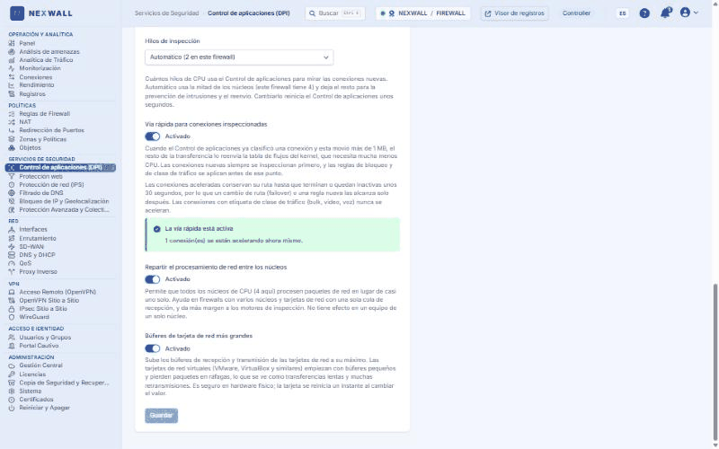
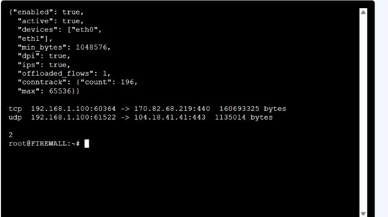

# KBA-18: Fast path (flow offload): comandos, estado y solución de problemas

**Aplica a.** Nexwall Firewall 26.2.1 (comandos verificados en esta versión).

## Qué es

Los dos motores de inspección miran solo el inicio de una conexión: DPI los primeros 32 paquetes, el IPS hasta su profundidad de inspección (1 MiB por defecto). Después, el resto de una transferencia larga solo necesita reenviarse. El **fast path** entrega esas conexiones a la tabla de flujos por software del kernel, que reenvía sus paquetes sin recorrer de nuevo el enrutamiento, el NAT y los hooks del firewall. Usa mucha menos CPU en descargas largas, respaldos y video, y deja más margen para las firmas.

**No** es el interruptor estándar "Software flow offloading": ese descarga todas las conexiones justo después del handshake y ocultaría el inicio de cada conexión al DPI y al IPS. El fast path de Nexwall descarga una conexión solo cuando

- está establecida, ha transportado más que el umbral (la profundidad de inspección del IPS mientras el IPS corre, al menos 256 KiB, y más de 32 paquetes), y
- cuando el DPI corre: el motor la marcó como `netify-analyzed`, no tiene etiqueta de clase de tráfico (`bulk`, `best_effort`, `video`, `voice`) y no está `netify-blocked`.

Todo vive en su propia tabla nftables, `inet nexwall_fastpath`. Eliminarla devuelve todas las conexiones a la ruta normal. Cualquier error también deja el tráfico en la ruta normal.

## Activar o desactivar


*Control de aplicaciones > Ajustes: opciones de rendimiento*

Interfaz: **Control de aplicaciones (DPI) > Ajustes > Rendimiento** o **Protección de red (IPS) > Ajustes > Rendimiento** (un solo interruptor para ambos); luego Guardar y aplicar los cambios pendientes.

Línea de comandos:

```sh
uci set nexwall_perf.main.fastpath=1      # 0 para desactivar
uci commit nexwall_perf
/etc/init.d/nexwall-fastpath reload       # lo aplica ahora (también ocurre en la próxima recarga de configuración)
```

Ajuste relacionado, manejado por la misma herramienta: `nexwall_perf.main.ring_buffers` (`1` sube los anillos de la tarjeta de red a su máximo al aplicar, independiente del fast path; vea [KBA-19](kba-19-inspection-settings.md)).

Opcional: `uci set nexwall_perf.main.min_bytes=2097152` sube el umbral (por defecto `auto`; los valores menores que 262144 se suben a ese valor).

## Comandos


*Salida de nexwall-fastpath status y list*

| Comando | Qué hace |
|---|---|
| `nexwall-fastpath status` | Una línea JSON: `enabled`, `active`, `devices`, `min_bytes`, `dpi`, `ips`, `offloaded_flows`, y `reason`/`error` cuando no está activo |
| `nexwall-fastpath list` | Las conexiones que están ahora en el fast path, las mayores primero: protocolo, origen, destino, bytes |
| `nexwall-fastpath apply` | Lee los ajustes y (re)crea la tabla; también vacía la tabla de flujos, así que cada conexión se evalúa de nuevo con las reglas actuales |
| `nexwall-fastpath stop` | Elimina la tabla de inmediato (el ajuste queda como está) |
| `/etc/init.d/nexwall-fastpath start \| reload \| stop` | Lo mismo mediante el servicio; se reaplica al cambiar `nexwall_perf`, `dpi`, `snort`, `network` y al subir o bajar interfaces |

Ejemplo:

```sh
# nexwall-fastpath status
{"enabled": true, "active": true, "devices": ["eth0", "eth1"], "min_bytes": 1048576, "dpi": true, "ips": true, "offloaded_flows": 3}

# nexwall-fastpath list
tcp  192.168.1.242:3350 -> 162.159.140.220:443  103919398 bytes
```

## Dónde ver el tráfico descargado

- **Interfaz:** la tarjeta Rendimiento muestra "Fast path activo" y cuántas conexiones están aceleradas (se actualiza cada 15 s).
- **Seguimiento de conexiones:** las conexiones aceleradas llevan la marca `[OFFLOAD]` y sus contadores de bytes siguen contando:

```sh
grep OFFLOAD /proc/net/nf_conntrack
conntrack -L 2>/dev/null | grep OFFLOAD
```

- **Reglas y contadores:** `nft list table inet nexwall_fastpath` (dispositivos de la tabla de flujos, reglas de etiqueta, regla de descarga).
- **Log del sistema:** cada aplicación, parada y falla se registra con la etiqueta `nexwall-fastpath`:

```sh
grep nexwall-fastpath /var/log/messages
```

## Leer `status`

| `reason` | Significado | Qué hacer |
|---|---|---|
| `disabled` | El interruptor está apagado | Nada, o actívelo |
| `not-applied` | El ajuste está activo pero aún no se aplicó | `/etc/init.d/nexwall-fastpath start` (registra los disparadores) y luego `reload` |
| `no-devices` | No se encontró interfaz activa para la tabla de flujos | Revise `ubus call network.interface dump`; corrija la interfaz y ejecute `nexwall-fastpath apply` |
| `error` | `nft` rechazó el conjunto de reglas (`error` trae el mensaje) | Revise los módulos del kernel `nf_flow_table`, `nft_flow_offload`; envíe el mensaje a soporte |

`offloaded_flows` en 0 con el interruptor activo es normal hasta que una conexión supere el umbral **y** el DPI la haya analizado. Una página web corta nunca llega al fast path.

## Conviene saber

- Una conexión acelerada mantiene su ruta hasta que termina o queda inactiva unos 30 segundos. Un cambio de ruta (failover de WAN) o una regla nueva de firewall/DPI le llega solo después. `nexwall-fastpath apply` (también se ejecuta tras cada recarga del DPI) vacía la tabla de flujos para que todo se evalúe de nuevo.
- Las conexiones con etiqueta de clase de tráfico (bulk, video, voz de las reglas de QoS del DPI) nunca se aceleran, porque el marcado DSCP lo hace un hook que los paquetes descargados omiten.
- La tabla de flujos tiene la opción `counter`: los contadores de bytes y paquetes de las conexiones aceleradas siguen al día, así que las estadísticas de tráfico siguen funcionando. (Sin ella, los contadores se congelarían en el punto de descarga.)
- Los túneles (OpenVPN, WireGuard, IPsec) no entran en la tabla de flujos; su tráfico no se acelera.
- El SQM / control de tráfico en la interfaz sigue aplicándose (actúa en la disciplina de cola, después del reenvío).
- En pruebas de laboratorio (firewall virtual) el fast path dio cerca de 10% más de rendimiento y cerca de 10% menos CPU por Gbit/s; las mayores ganancias vinieron del reparto de paquetes entre núcleos y de buffers de red mayores. Vea [KBA-20](kba-20-throughput-sizing.md). Mida en su hardware.

## Comprobaciones rápidas cuando algo parece mal

```sh
nexwall-fastpath status
nft list table inet nexwall_fastpath | head -30
grep -c OFFLOAD /proc/net/nf_conntrack
grep nexwall-fastpath /var/log/messages | tail
/etc/init.d/nexwall-fastpath status
```

Para descartar el fast path como causa de un problema, desactívelo y pruebe de nuevo:

```sh
uci set nexwall_perf.main.fastpath=0; uci commit nexwall_perf; nexwall-fastpath stop
```

## Qué recoger antes de contactar a soporte

1. `nexwall-fastpath status`, `nexwall-fastpath list | head`, `nft list table inet nexwall_fastpath`.
2. `grep nexwall-fastpath /var/log/messages`.
3. `uci show nexwall_perf; uci show dpi.engine; uci show snort.nfq`.
4. Las direcciones del cliente y del servidor afectados y la hora, para encontrar la conexión en `nexwall-fastpath list`.
