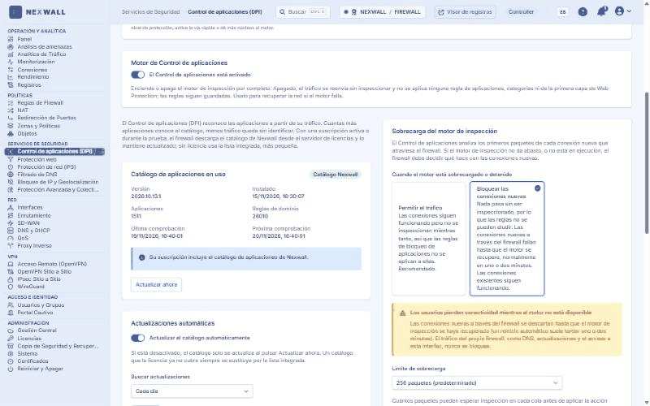
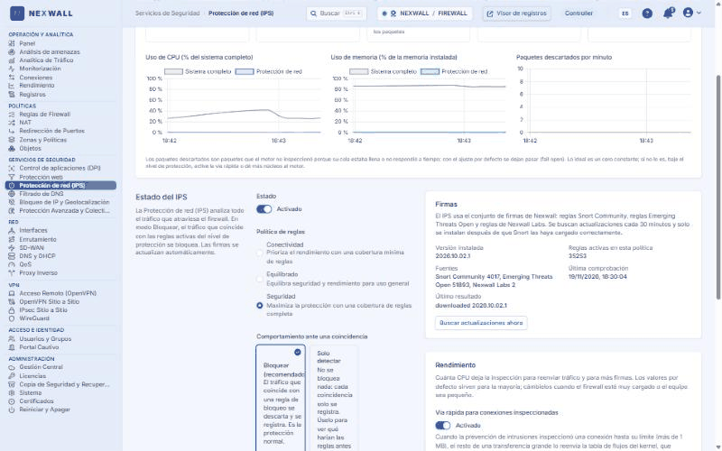
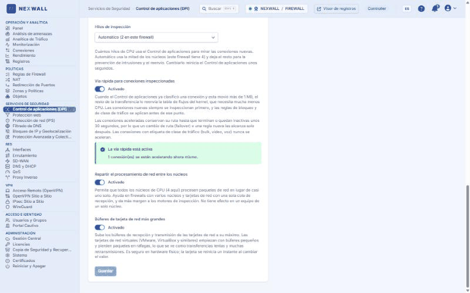
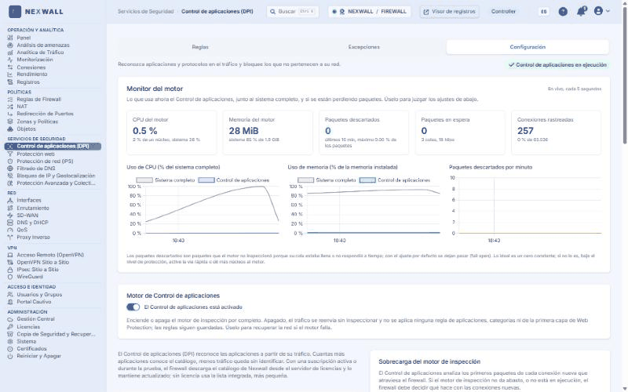

# KBA-0019: Ajustes de inspección: Control de aplicaciones (DPI) e IPS

Ambos motores leen paquetes de colas del kernel y comparten la CPU con el reenvío. Estos controles deciden cuánta CPU usan, qué pasa cuando no dan abasto y cómo reacciona el IPS ante una coincidencia. Los valores por defecto sirven para la mayoría de los firewalls. Cada ajuste de la interfaz se guarda como cambio pendiente: presione **Aplicar cambios** después.

**Aplica a.** Nexwall Firewall 26.2.1. Para dimensionar y medir vea [KBA-0020](kba-20-throughput-sizing.md).

## Dónde está cada ajuste

| Ajuste | Ubicación en la interfaz | UCI / comando |
|---|---|---|
| Hilos de inspección DPI | Control de aplicaciones (DPI) > Ajustes > Rendimiento | `dpi.engine.threads` (`auto`, `1`..`4`) |
| Comportamiento ante sobrecarga del DPI | Control de aplicaciones (DPI) > Ajustes > Sobrecarga del motor de inspección | `dpi.engine.overload_action` (`allow`, `block`) |
| Límite de cola del DPI | misma tarjeta | `dpi.engine.queue_limit` (`128`, `256`, `512`, `1024`) |
| Fast path | DPI > Ajustes > Rendimiento e IPS > Ajustes > Rendimiento (mismo interruptor) | `nexwall_perf.main.fastpath` (`0`, `1`) |
| Repartir el procesamiento de red entre núcleos | las mismas dos tarjetas (mismo interruptor) | `network.@globals[0].packet_steering` (`0`, `1`) |
| Buffers mayores de la tarjeta de red | las mismas dos tarjetas (mismo interruptor) | `nexwall_perf.main.ring_buffers` (`0`, `1`) |
| IPS activo/inactivo, nivel de protección | Protección de red (IPS) > Ajustes | `snort.snort.enabled`, `snort.snort.ns_policy` (`connectivity`, `balanced`, `security`) |
| Comportamiento ante una coincidencia | IPS > Ajustes | `snort.snort.action` (`default` = Bloquear, `alert` = Solo detectar) |
| Registrar también detecciones no bloqueadas | IPS > Ajustes | `snort.snort.ns_alert_excluded` (`0`, `1`) |
| Profundidad de inspección del IPS | sin interfaz (API/UCI) | `snort.nfq.max_inspect_bytes` (bytes, por defecto `1048576`, `0` = ilimitado) |
| Redes protegidas (HOME_NET) | IPS > Ajustes | `snort.snort.home_net` |
| Firmas | IPS > Ajustes > Firmas | `nexwall-ips-rules status \| update \| apply` |

## Control de aplicaciones (DPI)


*Control de aplicaciones > Ajustes: sobrecarga del motor de inspección*

**Hilos de inspección.** Cuántas instancias de captura (un hilo cada una más un hilo de detección) miran las conexiones nuevas. *Automático* usa la mitad de los núcleos, de 1 a 4, y 1 para el tráfico propio del firewall (2 desde 8 núcleos): un equipo de 2 núcleos recibe 1, uno de 4 recibe 2, uno de 8 recibe 4. El DPI solo necesita los primeros 32 paquetes de una conexión, por eso usa mucha menos CPU que el IPS. Más hilos que núcleos solo hacen competir a los motores. Cambiar el valor reinicia el Control de aplicaciones unos segundos (el número de instancias se crea al iniciar).

**Cuando el motor está sobrecargado o detenido.** *Permitir el tráfico* (por defecto, recomendado): si el motor no da abasto o no corre, las conexiones siguen funcionando pero no se inspeccionan, así que las reglas de aplicación no se aplican a ellas. *Bloquear conexiones nuevas*: nada pasa sin inspección; las conexiones nuevas fallan hasta que el motor vuelva (normalmente uno o dos minutos); las existentes siguen funcionando. El tráfico propio del firewall siempre falla abierto.

**Límite de cola.** Paquetes que pueden esperar por cola (128 a 1024). Más grande absorbe ráfagas y añade latencia; más pequeño pasa antes al comportamiento de sobrecarga. Mantenga 256 salvo que vea descartes.

## Protección de red (IPS)


*Protección de red (IPS) > Ajustes: nivel de protección, comportamiento ante una coincidencia y rendimiento*

**Nivel de protección.** *Conectividad* bloquea solo amenazas críticas de alta confianza (menos falsos positivos, conjunto de reglas más pequeño, menos CPU). *Equilibrado* añade amenazas importantes de alta confianza. *Seguridad* añade reglas de confianza media y escaneos/DoS (más protección, más falsos positivos, más CPU). Reglas de bloqueo aproximadas en el paquete actual: 3.900 / 22.600 / 35.200.

**Comportamiento ante una coincidencia.**
- *Bloquear (recomendado, por defecto)*: el tráfico que coincide con una regla de **bloqueo** del nivel elegido se descarta y se registra como `Drop`.
- *Solo detectar*: nada se bloquea, cada coincidencia solo se registra como `Alert`. Úselo para ver qué harían las reglas antes de bloquear. Se muestra una advertencia mientras está activo; vuelva a Bloquear al terminar.

**Registrar también detecciones no bloqueadas.** Añade reglas de solo detección (unas 7.600, nunca bloquean) para que Eventos de hoy muestre también tráfico sospechoso permitido (`Alert`). Más eventos y algo más de CPU. Déjelo apagado salvo que quiera esa visibilidad. La regla de prueba de alerta de Nexwall Labs (cabecera `X-Nexwall-IPS-Test: 1`) solo aparece con esto activo o en modo Solo detectar.

**Profundidad de inspección (`snort.nfq.max_inspect_bytes`).** El IPS deja de inspeccionar una conexión tras esta cantidad de bytes (ambos sentidos) y deja pasar el resto. Menor = menos CPU, pero las cargas tardías no se inspeccionan; `0` = sin límite (más CPU). También es el punto desde el cual el fast path puede tomar el control.

**Firmas.** Las entrega el servicio de firmas de Nexwall (reglas Snort Community, Emerging Threats Open y Nexwall Labs), se actualizan a diario en el servidor y el firewall las consulta cada 30 minutos. Un paquete nuevo se valida con Snort antes de usarse; si Snort lo rechaza, quedan las reglas anteriores. Vea *IPS > Ajustes > Firmas* ("Buscar actualizaciones ahora").

## Compartido: fast path y reparto de paquetes


*Control de aplicaciones > Ajustes: opciones de rendimiento*

**Fast path.** Reenvía el resto de las transferencias largas por la tabla de flujos del kernel después de que los motores terminaron con ellas (detalles, comandos y solución de problemas: [KBA-0018](kba-18-fast-path.md)). Activo por defecto en instalaciones nuevas (solo toca conexiones que los motores ya terminaron); desactívelo si necesita que cada paquete de las conexiones largas se inspeccione o que un cambio de regla llegue de inmediato a las conexiones existentes.

**Repartir el procesamiento de red entre núcleos (packet steering).** Permite que todos los núcleos procesen paquetes de red en vez de casi solo uno. Ayuda a firewalls con varios núcleos y tarjetas de red con **una sola cola de recepción** (tarjetas virtuales, muchas placas pequeñas); las tarjetas de servidor multicola ya reparten la carga. Sin efecto en equipos de un solo núcleo. Compruebe el efecto con `cat /sys/class/net/<wan>/queues/rx-0/rps_cpus` (una máscara con más de un bit) y `top` (carga en varios núcleos).

**Buffers mayores de la tarjeta de red (`ring_buffers`).** Sube los anillos de recepción y transmisión de las interfaces físicas al máximo del hardware (`ethtool -G <if> rx max tx max`, se aplica al arrancar, al cambiar interfaces y al cambiar el ajuste). Las tarjetas virtuales (e1000 en VMware, VirtualBox y similares) empiezan con 256 descriptores y pierden paquetes en ráfagas: TCP lento con miles de retransmisiones, pérdida de UDP. Compruebe con `ethtool -g <if>` (actual vs máximo). Seguro en hardware físico. Activo por defecto en instalaciones nuevas.

## Valores por defecto en una instalación nueva

| Ajuste | Por defecto | Por qué |
|---|---|---|
| Hilos de inspección DPI | Automático | la mitad de los núcleos, deja el resto al IPS y al reenvío |
| Nivel de protección del IPS | Equilibrado | medido a plena velocidad con los motores activos; Conectividad solo si el equipo es muy pequeño |
| Comportamiento del IPS | Bloquear | |
| Fast path | Activo | solo después de la inspección; cerca de +10% de rendimiento y -10% de CPU en laboratorio |
| Packet steering | Activo si hay más de un núcleo | tarjetas de una cola o virtuales pasaron de 100 a cerca de 700 Mbit/s |
| Buffers mayores de la tarjeta de red | Activo | las tarjetas virtuales pierden ráfagas con los buffers pequeños por defecto |

Las unidades existentes mantienen lo que tienen; los valores por defecto se crean solo cuando los ajustes `nexwall_perf` aún no existen.

## Volver a los valores por defecto

```sh
uci -q delete dpi.engine.threads
uci set dpi.engine.overload_action=allow; uci set dpi.engine.queue_limit=256
uci set nexwall_perf.main.fastpath=0
uci set network.@globals[0].packet_steering=0
uci set nexwall_perf.main.ring_buffers=0
uci set snort.snort.action=default; uci set snort.snort.ns_alert_excluded=0
uci set snort.nfq.max_inspect_bytes=1048576
uci commit; reload_config
```

## Monitor del motor


*Monitor del motor: CPU, memoria, paquetes descartados y conexiones rastreadas*

La pestaña Ajustes de Control de aplicaciones (DPI) y de Protección de red (IPS) empieza con un **Monitor del motor** en vivo (se actualiza cada 5 segundos): CPU del motor (porcentaje del sistema completo y de un núcleo) y del sistema, memoria del motor y del sistema, **paquetes descartados** (paquetes que el motor no inspeccionó porque su cola estaba llena o no respondió; se dejan pasar, falla abierto) como total de diez minutos, el peor porcentaje de tráfico y un gráfico por minuto, paquetes esperando en las colas, y las conexiones rastreadas frente al límite. El objetivo es un cero constante en paquetes descartados. Los valores salen de `ubus call ns.dpi get-engine-metrics` (igual para `ns.snort`).

## Qué recoger antes de contactar a soporte

`uci show dpi.engine; uci show nexwall_perf; uci show snort | grep -v oinkcode`, `nexwall-fastpath status`, `nexwall-ips-rules status`, `dpidbg status`, `cat /proc/net/netfilter/nfnetlink_queue`, el número de núcleos de CPU (`grep -c ^processor /proc/cpuinfo`), y la hora y el síntoma (lento, descartes, bloqueo indebido).
