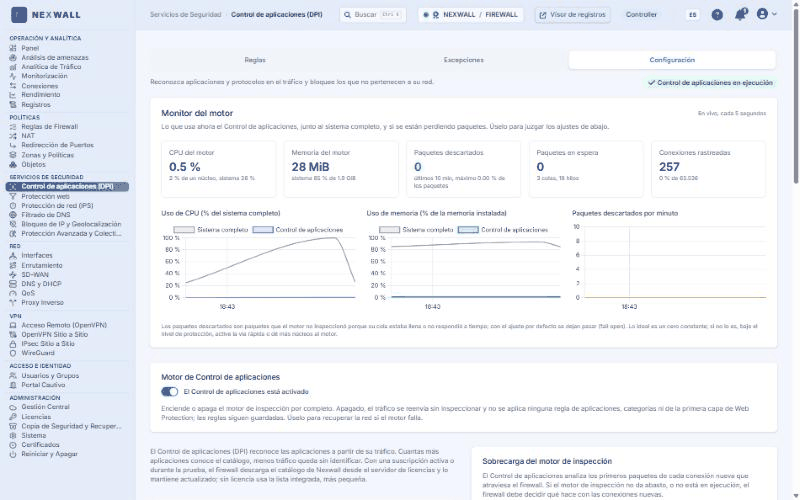

# KBA-20: Rendimiento, CPU y memoria: cómo medir y dimensionar

Úselo cuando el firewall va lento bajo inspección, pierde paquetes en ráfagas o necesita dimensionar una unidad nueva. Los ajustes se explican en [KBA-19](kba-19-inspection-settings.md).

**Aplica a.** Nexwall Firewall 26.2.1.

## Cómo comprobar el efecto


*Monitor del motor: CPU, memoria, paquetes descartados y conexiones rastreadas*

```sh
dpidbg status                                    # colas del DPI: paquetes en espera y contadores de veredicto
cat /proc/net/netfilter/nfnetlink_queue          # colas 50-5x DPI, 4-7 IPS: columna 6 = descartados con la cola llena
top -b -n1 | head -15                            # quién usa la CPU
nexwall-fastpath status                          # estado del fast path y conexiones aceleradas
nexwall-ips-rules status                         # paquete de firmas, política, última consulta
ls /var/log/snort                                # alertas del IPS (JSON)
```

Columnas de la cola: `queue_total` (en espera ahora) debe quedar cerca de 0; un `queue_dropped` que crece significa que el motor no da abasto: baje el nivel del IPS, active el fast path o dé más núcleos a los motores.

## Puntos de partida por hardware

| Hardware | Hilos DPI | Nivel IPS | Fast path | Packet steering | Buffers mayores |
|---|---|---|---|---|---|
| 1-2 núcleos | Automático (1) | Conectividad | Activo | Activo (2 núcleos) | Activo |
| 4 núcleos | Automático (2) | Equilibrado | Opcional (cerca de +10% en transferencias largas en laboratorio) | Activo (una tarjeta de una cola o virtual pierde la mayor parte de su velocidad sin esto) | Activo |
| 8+ núcleos | Automático (4) | Equilibrado o Seguridad | Activo | Normalmente innecesario en tarjetas multicola | Activo en tarjetas virtuales |

Son puntos de partida. Cambie un ajuste a la vez y compare.

## Tabla de conexiones y memoria

Cada conexión rastreada cuesta cerca de 5,6 KB (kernel, DPI e IPS juntos, medido con 77.000 conexiones), por eso el límite de conexiones se deriva de la memoria instalada: 32 entradas por MiB, al menos 65.536 (2 GiB: 65.536, 4 GiB: 131.072, 8 GiB: 253.952, 16 GiB: 524.288). `nexwall-fastpath apply` lo fija al arrancar y al recargar (`nexwall_perf.main.conntrack_auto=0` conserva un `net.netfilter.nf_conntrack_max` manual). El valor por defecto del kernel (cerca de 1.000.000 de entradas con 8 GiB) dejaría que los motores usen más memoria de la que tiene un firewall pequeño: el firewall de laboratorio dejó de responder cuando la tabla creció muy por encima de lo que cabía en sus 2 GiB. Vigile **Conexiones rastreadas** en el Monitor del motor; si se mantiene cerca del 100 % el límite es bajo para la cantidad de usuarios y la respuesta es más memoria, no una tabla mayor.

Las colas e hilos del IPS siguen el número de núcleos (hasta 16) automáticamente (`snort.nfq.cpu_auto=0` conserva un valor manual); cada hilo adicional añade unos 15 MB de memoria.

## Mediciones de laboratorio (firewall virtual, 4 vCPU, e1000)

VM cliente a través del firewall hacia una VM servidor, iperf3, 4 flujos TCP, sentido inverso, 3 x 10 s por línea (Mbit/s, media):

| Configuración | Resultado |
|---|---|
| Directo entre las dos VM (sin firewall) | cerca de 2.700 |
| Firewall, sin DPI/IPS, anillos por defecto, sin steering | 17 a 120, miles de retransmisiones |
| igual, anillos al máximo | 100, una retransmisión |
| anillos al máximo + packet steering | 694 |
| + DPI e IPS activos (equilibrado) | 736 |
| + fast path | 740 a 890 (dos pares A/B: fast path 866 y 920 Mbit/s con 60 y 52 % de CPU por Gbit/s, apagado 840 y 758 con 60 y 65) |

Lectura: en esta tarjeta virtual el primer límite fue el tamaño del anillo (UDP a 300 Mbit/s perdió 53 % con 256 descriptores, 0,3 % con 4096), el segundo la interrupción única que mantenía un núcleo al 100 % (el steering movió la carga: de 100 a cerca de 700 Mbit/s). Con esos dos resueltos, DPI e IPS cuestan poco en transferencias grandes, porque solo inspeccionan los primeros 32 paquetes / 1 MiB de cada conexión, y el fast path dio cerca de 10 % más de rendimiento con cerca de 10 % menos CPU por Gbit/s (dentro del ruido de un host compartido). Muchas conexiones pequeñas (3.000 peticiones HTTP cortas, 60 en paralelo): cerca de 155 peticiones/s con DPI e IPS activos frente a 163 a 184 sin ellos (el límite era el servidor de prueba). Los números absolutos dependen del hipervisor; úselos para comparar ajustes, no como especificaciones del producto.
