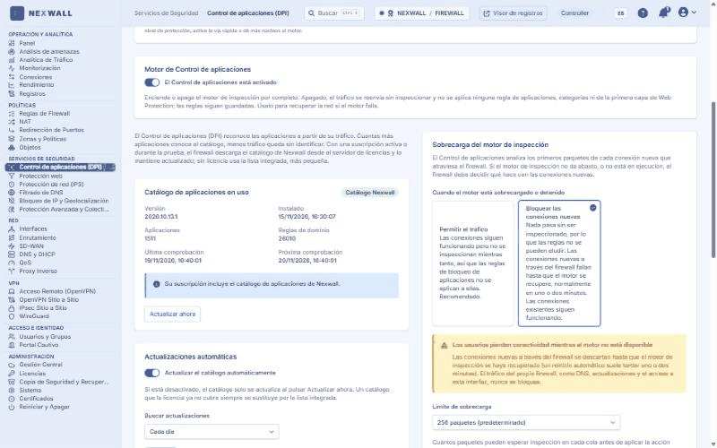

# KBA-21: Las conexiones nuevas se cuelgan aunque el firewall parece sano (cola DPI / IPS detenida)

**Aplica a.** Nexwall Firewall 26.0.0 y posteriores (comandos verificados en 26.2.1). **Gravedad:** alta: conexiones nuevas demoradas o fallando durante minutos.

## Síntomas

- SSH o la interfaz web no responden desde la WAN o la LAN, mientras una sesión **ya abierta** sigue funcionando (por ejemplo, la interfaz web se alcanza por otro puerto con una conexión antigua).
- Los usuarios de la LAN no pueden abrir conexiones nuevas (páginas nuevas, llamadas) mientras las descargas existentes continúan.
- Monitor > Flujos en vivo está **vacío** o congelado.
- CPU y memoria se ven normales (inactividad por encima de 95 %).
- Aparece la notificación "El motor de inspección de tráfico dejó de responder y fue recuperado" o el log contiene entradas de `nexwall-nfq-watchdog`.

## Causa

Los motores de inspección leen paquetes de colas del kernel (NFQUEUE). Si un lector deja de ser atendido, o es demasiado lento, los paquetes esperan en la cola y se detiene toda conexión cuyos primeros paquetes caen en esa cola. Las conexiones que ya pasaron sus primeros 32 paquetes no se ven afectadas. La regla de firewall `queue flags bypass` no se aplica porque el programa sigue corriendo. (Un motor que cae es distinto: falla abierto y el tráfico fluye.)

## Revise (2 minutos)

```sh
dpidbg status
```
Mire la tabla de colas: una cola con muchos paquetes **en espera** y un contador de **veredictos** que no aumenta entre dos ejecuciones está detenida (colas 50-57 = DPI, 4-7 = IPS).

```sh
ls -lt /root/nfq-stall/ | head            # informes de diagnóstico, el más nuevo primero
cat /root/nfq-stall/events.log            # historial: hora, colas, servicio, acción
```

## Resolución

Automática: el watchdog (`nexwall-nfq-watchdog`, cada minuto) reinicia al dueño de la cola detenida, como máximo `max_restarts` veces por hora. Espere recuperación en unos 2 minutos.

Manual, si el watchdog está apagado o alcanzó su límite:

```sh
/etc/init.d/netifyd restart        # colas DPI 50-57
/etc/init.d/snort restart          # colas IPS 4-7
```

Si no puede iniciar sesión: use la consola. Los puertos de administración (22, 443, 9090) hacia el propio firewall están excluidos de la cola DPI, así que siguen accesibles aunque el DPI se detenga; si aun así no responden, sospeche de las colas del IPS o del sistema, no del DPI.

## Qué recoger antes de contactar a soporte

1. Las carpetas de informe más nuevas en `/root/nfq-stall/` (`report.txt`), `events.log`, y `netifyd.core.gz` si `watchdog.core` estaba activo (contiene metadatos de tráfico: envíelo solo a soporte).
2. La salida de `dpidbg status` y `dpidbg unknown` si la queja es sobre clasificación de tráfico.
3. Si hubo una recarga de `netifyd` poco antes (actualización de datos/licencia del DPI, cambio de regla): `grep netifyd` en el visor de logs alrededor de la hora del evento.
4. Hora en que empezó y terminó el problema, y qué puertos o clientes se vieron afectados.

## Ajustes y prevención

| Ajuste (`/etc/config/netifyd`) | Por defecto | Efecto |
|---|---|---|
| `watchdog.enabled` | `1` | `0` apaga el watchdog |
| `watchdog.restart` | `1` | `0` = detecta, informa y alerta, nunca reinicia |
| `watchdog.max_restarts` | `3` | reinicios por hora antes de que solo informe y alerte |
| `watchdog.backlog` | `64` | paquetes en espera en cada muestra que cuentan como detención |
| `watchdog.core` | `0` | `1` guarda un volcado de memoria del motor detenido (para soporte) |
| `config.mgmt_ports` | `22 443 9090` | puertos TCP del tráfico de administración del propio firewall que omiten el DPI |
| `dpi.engine.queue_limit` | `256` | paquetes que pueden esperar por cola (128, 256, 512 o 1024); se escribe en `10-nfqueue.conf: queue_maxlen` |
| `dpi.engine.overload_action` | `allow` | qué pasa con las **conexiones nuevas a través del firewall** cuando una cola está llena o el motor no corre: `allow` = pasan sin inspección (las reglas de aplicación no se les aplican), `block` = se descartan hasta que el motor vuelva |

## Decisión ante sobrecarga: permitir o bloquear


*Control de aplicaciones > Ajustes: sobrecarga del motor de inspección*

Control de aplicaciones (DPI) > Ajustes > **Sobrecarga del motor de inspección**, o `/etc/config/dpi` sección `engine`:

```
config engine 'engine'
	option overload_action 'allow'   # o 'block'
	option queue_limit '256'         # 128, 256, 512 o 1024
```

- **allow (por defecto, recomendado):** cuando el motor no da abasto (su cola está llena) o no corre, las conexiones nuevas pasan sin inspección. Nada se rompe para los usuarios, pero las reglas de bloqueo de aplicaciones no se aplican a esas conexiones mientras tanto.
- **block:** nada pasa sin inspección, así que las reglas no se pueden eludir, pero las conexiones nuevas a través del firewall fallan hasta que el motor vuelva (un reinicio automático toma uno o dos minutos). Las conexiones existentes siguen funcionando.
- Solo el tráfico **reenviado** sigue `block`. El tráfico propio del firewall (DNS, actualizaciones, licencias) y el acceso a la interfaz web y SSH nunca se bloquean.
- Un motor *atascado* (vivo pero sin atender) lo cubre el watchdog en ambos modos: los paquetes esperan hasta alcanzar el límite de la cola, luego se aplica la acción; el watchdog reinicia el motor.
- Cambiar el ajuste requiere **Aplicar cambios**; la regla del firewall y las colas del motor se actualizan sin reiniciarlo.

## Notas

- Los informes que guarda el watchdog son lo que soporte necesita para analizar una detención: recójalos.
- Reiniciar el motor DPI reinicia la tabla de flujos en vivo; las reglas de bloqueo siguen aplicándose a las conexiones ya etiquetadas.
