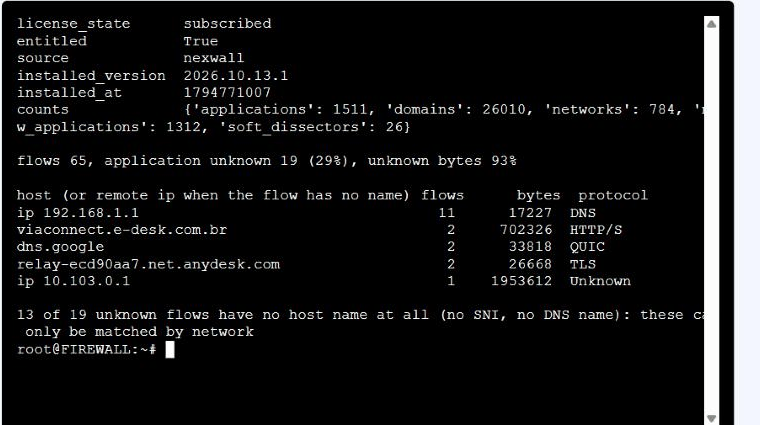

# KBA-22: El tráfico aparece como "Desconocido" o una aplicación no se bloquea con Control de aplicaciones (DPI)

**Aplica a.** Nexwall Firewall 26.0.0 y posteriores (comandos verificados en 26.2.1).

## Síntomas

- Monitor > Flujos en vivo, o las reglas de Control de aplicaciones, muestran muchos flujos con aplicación "Desconocida" (solo se ve el protocolo, por ejemplo `HTTPS` o `DNS`).
- Una regla que bloquea una aplicación no detiene un servicio que se esperaba detener.
- La proporción de tráfico desconocido es alta justo después de terminar la prueba.

## Cómo decide el firewall a qué aplicación pertenece un flujo

El motor DPI lee el **nombre** que usa una conexión (el nombre de servidor TLS, el nombre DNS que consultó el cliente, o una pista aprendida de respuestas DNS anteriores) y lo busca en el **catálogo de aplicaciones**: reglas de dominio (`cnn.com` también cubre `edition.cnn.com`), reglas de red y algunas reglas de protocolo. Sin regla no hay aplicación: el flujo conserva solo su protocolo. Las conexiones cifradas sin nombre legible (ICMP, IP directa, parte del tráfico QUIC/VPN) solo se pueden asociar por red.

Por eso "Desconocido" casi siempre significa que **el catálogo no tiene regla para ese nombre**, no que el motor falló.

## Revise (2 minutos)


*Salida de nexwall-dpi-catalog status y dpidbg unknown*

1. **¿Qué catálogo está en uso?** Control de aplicaciones (DPI) > Ajustes muestra el origen: el **catálogo Nexwall** (unas 1.500 aplicaciones) o la **lista integrada** (199 aplicaciones). En la CLI: `nexwall-dpi-catalog status`.
   - `source: open` y licencia `trial` o `subscribed`: el catálogo aún no está instalado. Presione **Actualizar ahora**, o lea `last_error` en el estado (¿sin ruta al servidor de licencias? ¿unidad aún sin registrar?).
   - `source: open` y licencia `unlicensed`: terminó la prueba y no hay suscripción activa; la lista integrada está en uso por diseño. Activar una suscripción restaura el catálogo automáticamente en unos 10 minutos.
2. **¿Qué es exactamente lo desconocido?**
   ```sh
   dpidbg unknown -n 30
   ```
   Lista la proporción de flujos y bytes desconocidos y los principales hosts detrás de ellos, y cuántos flujos desconocidos no tienen nombre.
3. **¿Necesita el detalle de un cliente?** Una captura de depuración corta (pausa la inspección mientras corre; use una ventana de mantenimiento):
   ```sh
   dpidbg capture -s 45 -i <ip-del-cliente>
   ```
   La última sección, "protocol-only flows by host", es la lista de nombres que hay que añadir al catálogo.

## Resolución

| Hallazgo | Qué hacer |
|---|---|
| Lista integrada en uso aunque hay licencia | Control de aplicaciones (DPI) > Ajustes > **Actualizar ahora**; revise el error que se muestra |
| Prueba terminada, sin suscripción | Active una suscripción (Administración > Licencias) |
| Catálogo instalado, un servicio sigue desconocido | Envíe a soporte los nombres de host de `dpidbg capture`; se añaden al catálogo (las adiciones curadas se publican con la siguiente versión del catálogo) |
| Flujos sin nombre | Esperado en ICMP y tráfico IP directo; bloquee por red con una regla de firewall o un objeto |
| Una regla de bloqueo no detiene una app | El servicio puede servirse desde un CDN clasificado como aplicación propia (por ejemplo un sitio de video cuyo contenido viene de Fastly); añada una regla para esa aplicación también, o revise en Flujos en vivo qué aplicación tienen los flujos que parecen bloqueados |

## Ajustes

Control de aplicaciones (DPI) > Ajustes: actualización automática activada/desactivada y la frecuencia de consulta (de cada hora a semanal). Apagar las actualizaciones automáticas conserva el catálogo actual hasta que presione Actualizar ahora, **salvo** que un catálogo que la licencia ya no cubre siempre se reemplaza por la lista integrada.

## Notas

- Cambiar una regla del DPI surte efecto en segundos (el motor recarga las reglas; sin reinicio). Una conexión que ya estaba bloqueada sigue bloqueada hasta que termine, aunque se quite la regla.
- Tras una actualización de firmware el catálogo se reinstala automáticamente.
- Relacionado: [KBA-21](kba-21-dpi-engine-stall.md).
