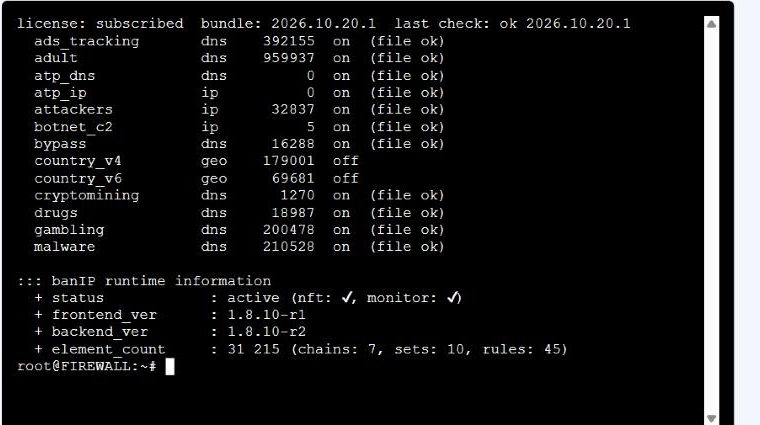

# KBA-23: Listas de Threat Shield: revisar y resolver problemas

**Aplica a.** Nexwall Firewall 26.2.1. Cómo funcionan las listas y su costo de memoria: [KBA-24](kba-24-threat-shield-lists.md).

## Solución de problemas

**Sin listas / "not licensed".** `nexwall-threat-feeds status` muestra `license: unlicensed` o `last check: not licensed`. Registre el firewall o pida una prueba; revise `licensectl state`.

**"update failed".** `status` muestra el motivo. Típico: el firewall no alcanza el servidor de licencias (revise `licensectl state`), o un archivo no coincidió con su hash firmado (reintente con `--force`; si se repite, envíe el mensaje a soporte). Una actualización fallida nunca elimina las listas que ya están en el firewall.

**Categoría activada pero no bloquea.** `status` debe mostrar `(file ok)` para ella; si no, ejecute `nexwall-threat-feeds sync`. Luego `/etc/init.d/adblock status` debe listarla en los feeds activos. Prueba: `nslookup <dominio listado> 127.0.0.1` responde NXDOMAIN. Un cliente que usa su propio DNS (DoH, un 8.8.8.8 fijo) evita el filtro salvo que la imposición de DNS esté activa (Threat Shield > Filtrado DNS > Ajustes: los puertos 53 y 853 se redirigen al firewall).

**Un sitio que debe funcionar está bloqueado.** Añada el dominio a la lista de permitidos de DNS (Threat Shield > Filtrado DNS > Permitidos). Repórtelo a soporte con la categoría: los falsos positivos se corrigen en la compilación diaria (la compilación tiene su propia lista de permitidos de dominios críticos).

**banIP muestra "processing" durante minutos.** banIP descarga los feeds uno por uno. Las listas IP de Nexwall son locales y toman segundos; la parte lenta es el bloqueo geográfico (feed `country`, una descarga por país, de un tercero) y cualquier feed de la lista propia de banIP que esté activo. Revise `grep banIP /var/log/messages`.

**El DNS deja de responder un momento tras un cambio.** dnsmasq se reinicia para cargar las listas (vea [Memoria y velocidad](kba-24-threat-shield-lists.md#memoria-y-velocidad)). Si dura minutos, las listas son demasiado grandes para la memoria: apague las categorías mayores.

## Comandos

*Salida de nexwall-threat-feeds status y banIP status*

| Comando | Qué hace |
|---|---|
| `nexwall-threat-feeds status` | estado de la licencia, versión del paquete, última consulta, cada categoría con entradas, activa/inactiva y si su archivo está en el firewall |
| `nexwall-threat-feeds status --json` | lo mismo para scripts; incluye la memoria DNS estimada de las listas activas (`dns_memory_mib`) |
| `nexwall-threat-feeds update [--force]` | consulta el servidor y descarga lo que está activo (no toca adblock ni banIP) |
| `nexwall-threat-feeds sync` | actualiza y luego recarga adblock y banIP si algo cambió (lo que ejecuta cron) |
| `nexwall-threat-feeds feeds-dns` / `feeds-ip` | las definiciones de feeds entregadas a adblock / banIP (las llaman `ts-dns` / `ts-ip`) |
| `/etc/init.d/adblock status` | dominios bloqueados, feeds activos, memoria de dnsmasq |
| `/etc/init.d/banip status` | elementos en los conjuntos IP, feeds activos |

Archivos: `/mnt/data/threat-feeds/` (catálogo `manifest.json`, `state.json`, una carpeta por versión, se conservan las dos más nuevas), `/etc/adblock/adblock.custom.feeds`, `/etc/banip/banip.custom.feeds`. Log: `grep nexwall-threat-feeds /var/log/messages`.

## Qué recoger antes de contactar a soporte

`nexwall-threat-feeds status --json`, `/etc/init.d/adblock status`, `/etc/init.d/banip status`, `uci show adblock.global`, `uci show banip.global | grep -v oinkcode`, `grep -E "nexwall-threat-feeds|adblock|banIP" /var/log/messages | tail -50`, `free -m`, y el nombre del dominio o la dirección bloqueada por error o que no se bloquea.
