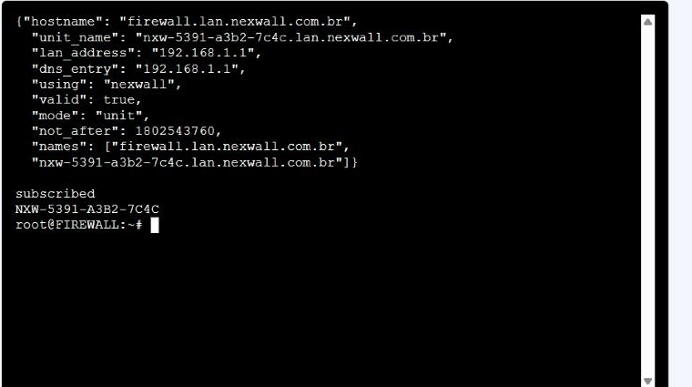

# KBA-0025: Dirección y certificado de la interfaz web

Aplica a firmware 26.0.0-rc4 y posteriores. El firmware hasta rc3 usa un certificado compartido para `firewall.nexwall.com.br` (vea la última sección).

## Qué escribir

| Dirección | Resultado |
|---|---|
| `https://firewall.lan.nexwall.com.br` | la interfaz web, **con un certificado que el navegador confía** (sin advertencia). Es la dirección de la etiqueta. |
| `https://<serie>.lan.nexwall.com.br` | lo mismo, por el número de serie de la unidad en minúsculas, por ejemplo `https://nxw-5391-a3b2-7c4c.lan.nexwall.com.br`. |
| `http://192.168.1.1` (o la dirección LAN que configuró), `http://firewall.lan` | una página pequeña que abre la dirección confiable, o muestra el enlace directo si el equipo no puede alcanzarla. |
| `https://192.168.1.1`, `https://firewall.lan` | la interfaz web, pero el navegador **advierte del certificado**: ninguna autoridad pública emite certificados para direcciones privadas. Acepte la advertencia una vez o use la dirección confiable. |

## Cómo funciona

1. El firewall responde por sí mismo los dos nombres anteriores: su servidor DNS devuelve la dirección LAN de la unidad. Por eso el equipo debe **usar el firewall como servidor DNS** (lo normal cuando el equipo recibe su dirección del firewall por DHCP).
2. La unidad genera su propia clave privada (nunca sale de la unidad) y pide al servidor de licencias de Nexwall un certificado para sus dos nombres. El servidor consulta a Let's Encrypt, que valida los nombres mediante DNS, y la unidad instala la respuesta tras comprobar la firma del servidor, los nombres y su clave.
3. Esto empieza unos minutos después del primer registro en el servidor de licencias (se necesita internet y una unidad registrada) y se revisa cada 30 minutos; el certificado se renueva automáticamente 28 días antes de vencer (es válido por 90 días).
4. Hasta que haya un certificado válido instalado, y cada vez que deje de ser válido, la interfaz web mantiene (o vuelve a) su propio certificado autofirmado, así que siempre se alcanza por la dirección directa.

## Comandos (en el firewall)

*Salida de nexwall-webui-cert status, licensectl state y el número de serie*

| Comando | Qué hace |
|---|---|
| `nexwall-webui-cert status` | qué está en uso: `using` (`nexwall` o `self-signed`), `valid`, `mode` (`unit` = el certificado de esta unidad, `shared` = el compartido del firmware antiguo, `none`), nombres, vencimiento (segundos epoch) |
| `nexwall-webui-cert sync` | hacerlo ahora: entradas DNS y luego solicitar/renovar el certificado (hasta unos 2,5 minutos mientras corre la validación) |
| `nexwall-webui-cert dns` | solo las entradas DNS (tras cambiar la dirección LAN) |
| `nexwall-webui-cert revert` | volver al certificado autofirmado |
| `grep nexwall-webui-cert /var/log/messages` | qué pasó en las últimas ejecuciones |

Verifique desde un equipo: `nslookup firewall.lan.nexwall.com.br 192.168.1.1` debe responder `192.168.1.1`.

## Solución de problemas

| Síntoma | Causa | Qué hacer |
|---|---|---|
| El navegador advierte en `https://192.168.1.1` | esperado para una dirección, no un nombre | use `https://firewall.lan.nexwall.com.br` |
| "No se puede acceder a este sitio" / `ERR_NAME_NOT_RESOLVED` para el nombre confiable | el equipo no usa el firewall como servidor DNS (DNS fijo como 8.8.8.8, una VPN, "DNS seguro" en el navegador, otro router delante) | configure el equipo para recibir DNS del firewall, o apague el DNS seguro del navegador; pruebe con el `nslookup` anterior. Mientras tanto use `http://192.168.1.1`, que muestra el enlace directo |
| La página del puerto 80 dice que no se pudo alcanzar la dirección segura | misma causa | igual |
| El nombre confiable abre pero el navegador aún advierte (certificado autofirmado) | aún no hay certificado propio instalado: `nexwall-webui-cert status` muestra `using: self-signed` | espere a la próxima ejecución o ejecute `nexwall-webui-cert sync`; lea las líneas del log; vea las filas siguientes |
| `could not get the own certificate: ... HTTP 401` o `DEVICE_ALREADY_REGISTERED` | la unidad no está registrada en el servidor de licencias | vea [KBA-0026](kba-26-licensing.md): el revendedor hace **Reset device** y luego **Synchronize** en la unidad |
| `could not get the own certificate: request failed` / timeout | sin internet o sin DNS en el firewall | revise la WAN; `nslookup license.nexwall.com.br` en el firewall |
| `the certificate is still being issued, the next run asks again` | la validación tarda más de 2,5 minutos | nada, la próxima ejecución (30 minutos) la termina |
| `ISSUE_FAILED` con un texto | Let's Encrypt o la validación fallaron esta vez | el servidor reintenta tras 15 minutos; si se repite por horas, envíe el texto a soporte |
| `RATE_LIMIT` | esta unidad pidió más de 4 certificados nuevos en una semana (típico tras varios restablecimientos de fábrica: cada uno genera una clave nueva) | espere una semana o consulte a soporte |
| `NAMES` o `UNIT_SERIAL` | falta el número de serie de la unidad o cambió | `cat /etc/nexwall-license/serial` debe mostrar `NXW-XXXX-XXXX-XXXX`; registre la unidad de nuevo ([KBA-0026](kba-26-licensing.md)) |
| `ERR_CERT_DATE_INVALID` o "certificado aún no válido" | el reloj del equipo o del firewall está mal | ajuste la hora en ambos; en el firewall `date` y los ajustes de NTP |
| El nombre dejó de funcionar tras cambiar la dirección LAN | las entradas DNS apuntan a la dirección anterior | `nexwall-webui-cert dns` (también ocurre solo en 30 minutos) |
| Otro servidor DNS delante bloquea el nombre ("DNS rebinding protection") | se descarta una dirección privada en la respuesta de un nombre público | permita `lan.nexwall.com.br` como dominio privado en ese servidor DNS, o haga que los equipos consulten al firewall |
| La interfaz web no abre tras un cambio de certificado | el servidor web no aceptó los archivos nuevos | la herramienta vuelve sola al certificado autofirmado; si no: `nexwall-webui-cert revert` |

## Bueno saber

- Cada unidad tiene un certificado y una clave distintos. Un restablecimiento de fábrica (o reinstalación) genera una clave nueva y una nueva solicitud de certificado.
- Los certificados los emite Let's Encrypt; los nombres `firewall.lan.nexwall.com.br` y el nombre con el número de serie son nombres públicos en los registros de transparencia de certificados (contienen el número de serie de la unidad, ningún otro dato).
- Firmware antiguo (hasta 26.0.0-rc3): `https://firewall.nexwall.com.br` con un certificado compartido, sin nada que configurar. El firmware nuevo lo sigue usando solo como respaldo.
