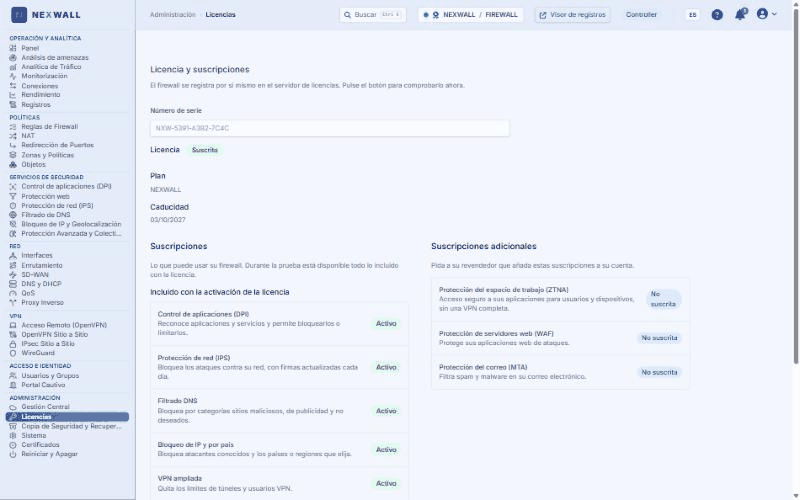

# KBA-0026: Licencias, suscripciones y registro

**Aplica a.** Nexwall Firewall 26.0.0 y posteriores (comandos verificados en 26.2.1).

## Cómo obtiene licencia un firewall

1. El firewall se registra solo: el componente de licencias se presenta al servidor de licencias (`https://license.nexwall.com.br`) tras el primer arranque, cuando la red está activa, y luego cada 15 minutos. No se escribe ningún código. La unidad aparece en el panel como **sin asignar**, con su número de serie (`NXW-XXXX-XXXX-XXXX`).
2. Empieza con una **prueba de 30 días** (el panel puede extenderla, tantas veces como haga falta). Durante la prueba están disponibles los cinco módulos base: Control de aplicaciones (DPI), Protección de red (IPS), Filtrado DNS, Bloqueo de IP y geo y VPN Extendida.
3. El revendedor asigna el número de serie a un socio en el panel y aplica la suscripción (abajo). Solo entonces la unidad pasa a **Suscrita**. Estar asignada a un socio no basta.
4. La licencia firmada (un arrendamiento de 14 días, renovado en cada consulta) lista los módulos. Web Server Protection (WAF) y Email Protection (MTA) son complementos aparte: aparecen como "No suscrito" y sus funciones aún no están disponibles.

## En el firewall

*Administración > Licencias*

Página Licencias: número de serie, el estado (Prueba con los días restantes, Suscrita, Sin licencia), las suscripciones (activas / no activas, módulos base y adicionales) y el botón **Sincronizar con el servidor**. Desde la línea de comandos: `ubus call ns.subscription info`, `ubus call ns.subscription sync`, `licensectl state`, `licensectl entitlements`.

## Solución de problemas

| Síntoma | Causa | Qué hacer |
|---|---|---|
| La página dice que el firewall aún no habló con el servidor | aún sin internet, o la primera consulta no se ejecutó | presione **Sincronizar con el servidor**; revise la WAN y el DNS |
| "already registered ... ask your reseller to reset the device" (`DEVICE_ALREADY_REGISTERED`) | la unidad se reinstaló y el servidor aún guarda su token de dispositivo anterior | revendedor: página Firewalls, **Reset device**; luego presione **Sincronizar** en la unidad |
| IPS, listas DNS o catálogo de aplicaciones fallan con HTTP 401 | igual que arriba: sin token de dispositivo válido | igual que arriba |
| Prueba aunque la unidad está asignada | el socio no tiene suscripción de módulos vigente | **Activate license** en la página del socio |
| Un módulo muestra "No activo" | el socio no tiene suscripción para él, o venció | página del socio, suscripciones |

La prueba que recibe una unidad sin ningún contacto con el servidor (primeras 24 horas) es solo un arranque: pasado ese tiempo la unidad queda sin licencia hasta que hable con el servidor.

## Para revendedores: panel del servidor de licencias

| Tarea | Dónde |
|---|---|
| Suscribir a un socio a los cinco módulos base | Página del socio, **Activate license** |
| Suscribir o quitar un módulo (con su propia fecha de fin) | Página del socio, tabla **Modules & Subscriptions**, **Save subscriptions** |
| Asignar una unidad | Página Firewalls, **Assign to...** |
| Extender la prueba | Página Firewalls, **Extend trial +30d** |
| Dejar que una unidad reinstalada se registre de nuevo | Página Firewalls, **Reset device** |
