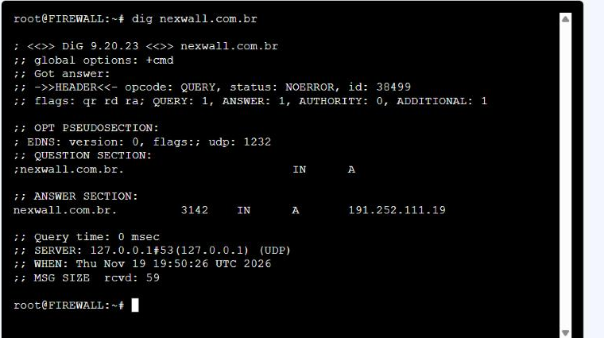
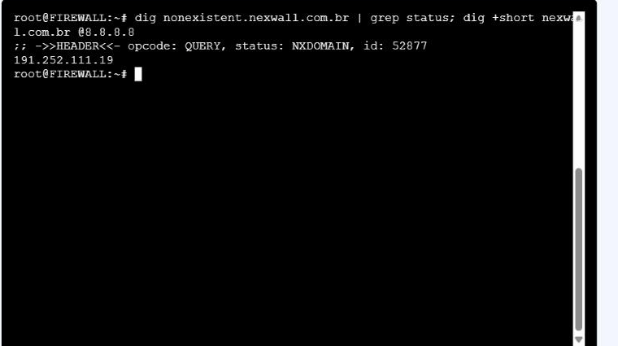

# KBA: Solucionar problemas de DNS desde la línea de comandos

**Síntoma.** Un sitio o servicio "no abre", pero hacer ping a su dirección IP funciona. O un nombre se resuelve desde
su portátil y no desde la LAN.

**Se aplica a.** Nexwall Firewall 26.2.1. Los comandos se ejecutan como `root` por SSH, por la consola o desde el
[terminal del controller](../administration/central-management.md).

:::note Qué está instalado
`dig` y `nslookup` están instalados y funcionan de fábrica. **`host` no está instalado**, ni tampoco `telnet`
(vea en la [KBA de conectividad](kba-cli-connectivity.md) los sustitutos). Si un comando responde `not found`,
revise la ortografía y use `command -v <nombre>` antes de suponer una falla.
:::

## 1. Pregunte al resolutor de la propia unidad

```bash
dig nexwall.com.br
```

```text
;; ->>HEADER<<- opcode: QUERY, status: NOERROR, id: 60522
;; flags: qr rd ra; QUERY: 1, ANSWER: 1, AUTHORITY: 0, ADDITIONAL: 1

;; ANSWER SECTION:
nexwall.com.br.		3594	IN	A	191.252.111.19

;; Query time: 0 msec
;; SERVER: 127.0.0.1#53(127.0.0.1) (UDP)
```



*Captura: dig respondido por el resolvedor de la propia unidad, estado NOERROR.*


Lea tres cosas: **`status`**, la **ANSWER SECTION** y la línea **SERVER**. El servidor es `127.0.0.1`, el resolutor
del propio firewall (`dnsmasq`). Para una respuesta corta, añada `+short`:

```bash
dig +short nexwall.com.br
```

| `status` | Significado | Siguiente paso |
|---|---|---|
| `NOERROR` con respuesta | El nombre se resuelve | El problema no es DNS, pase a la [KBA de conectividad](kba-cli-connectivity.md) |
| `NOERROR` **sin** respuesta | El nombre existe pero no tiene registro de ese tipo (por ejemplo, sin `AAAA`) | Pruebe `dig A <nombre>` y `dig AAAA <nombre>` |
| `NXDOMAIN` | El nombre no existe | Revise la ortografía y compare con un resolutor público (paso 2) |
| `SERVFAIL` | El servidor de salida no pudo responder | Pruebe los servidores de salida (paso 3) |
| `communications error ... timed out` | El servidor no respondió en absoluto | El resolutor está caído o inalcanzable (paso 4) |

## 2. Compare con un resolutor público

Pregunte directamente a un servidor público, sin pasar por el resolutor del firewall:

```bash
dig +short nexwall.com.br @8.8.8.8
```

```text
191.252.111.19
```



*Captura: NXDOMAIN para un nombre que no existe y la respuesta de un resolvedor público como comparación.*


| Resolutor del firewall | Resolutor público | Conclusión |
|---|---|---|
| Falla | Funciona | El problema está dentro del firewall: `dnsmasq`, sus servidores de salida o el [filtrado de DNS](../security-services/dns-filtering.md) |
| Funciona | Funciona | DNS está bien; mire el cliente (su configuración DNS, una caché, una VPN o un proxy en el PC) |
| Falla | Falla | El nombre realmente no se resuelve, o el firewall no tiene internet. Revise primero la WAN |

El [filtrado de DNS](../security-services/dns-filtering.md) también puede cambiar a qué se resuelve un nombre, así que
una categoría filtrada parece un problema de DNS en el cliente. Cuando un sitio falla y el resto funciona, compare las
dos respuestas y revise las listas de filtrado antes de buscar en otro lado.

## 3. Revise los servidores de salida

El firewall reenvía a los servidores que recibió del proveedor o que usted definió en la página DNS y DHCP.

```bash
cat /etc/resolv.conf
cat /tmp/resolv.conf.d/resolv.conf.auto
```

```text
search lan
nameserver 127.0.0.1
nameserver ::1
```

`/etc/resolv.conf` siempre apunta al propio firewall. Los servidores a los que reenvía están en
`resolv.conf.auto`, un bloque por interfaz (aquí la WAN, cuya puerta de enlace también actúa como resolutor):

```text
# Interface wan
nameserver 192.168.0.1
search Home
```

Pruebe cada servidor de salida:

```bash
dig +short nexwall.com.br @<servidor-de-salida> +time=3 +tries=1
```

Un servidor que no responde es el que hay que quitar o reemplazar. Dos o más servidores que funcionen evitan un único
punto de falla.

## 4. Un tiempo de espera agotado: ¿se alcanza el resolutor?

```bash
dig +short nexwall.com.br @10.255.255.1 +time=2 +tries=1
```

```text
;; communications error to 10.255.255.1#53: timed out
;; no servers could be reached
```

Así se ve un servidor inalcanzable (el código de salida es `9`). A continuación:

```bash
/etc/init.d/dnsmasq status
netstat -tulnp | grep ':53 '
```

```text
running
tcp   0   0 192.168.1.1:53   0.0.0.0:*   LISTEN   103916/dnsmasq
udp   0   0 192.168.1.1:53   0.0.0.0:*            103916/dnsmasq
```

Si `dnsmasq` no está en ejecución, o nada escucha en la dirección de la LAN, reinícielo y lea su registro:

```bash
/etc/init.d/dnsmasq restart
grep dnsmasq /var/log/messages | tail -20
```

Para comprobar la configuración sin reiniciar:

```bash
dnsmasq --test
```

```text
dnsmasq: syntax check OK.
```

## 5. Siga la resolución desde la raíz

Cuando la respuesta es incorrecta, o solo fallan algunos nombres, rastree todo el camino:

```bash
dig +trace nexwall.com.br
```

El rastreo va desde los servidores raíz hasta los autoritativos. Líneas como
`UDP setup ... failed: network unreachable` para direcciones IPv6 son normales en una red sin IPv6; mire la última
línea, que da la respuesta final y de dónde vino.

## 6. Referencia rápida

| Tarea | Comando |
|---|---|
| Resolver con el resolutor de la unidad | `dig <nombre>` |
| Solo la respuesta corta | `dig +short <nombre>` |
| Un tipo de registro concreto | `dig MX <nombre>`, `dig AAAA <nombre>`, `dig TXT <nombre>` |
| Usar un servidor concreto | `dig @1.1.1.1 <nombre>` |
| Búsqueda inversa | `dig -x <ip>` |
| Camino completo desde la raíz | `dig +trace <nombre>` |
| Lo mismo con `nslookup` | `nslookup <nombre>` o `nslookup <nombre> <servidor>` |
| DNS sobre HTTPS | `dig +https <nombre>` |
| Capturar tráfico DNS en la WAN | `tcpdump -i <interfaz-wan> -n udp port 53` |

## Páginas relacionadas

- [KBA: Probar conectividad, puertos y tráfico desde la línea de comandos](kba-cli-connectivity.md)
- [KBA: Verificar y solucionar problemas de servicios desde la línea de comandos](kba-cli-services.md)
- [DNS y DHCP](../network/dns-dhcp.md)
- [Filtrado de DNS](../security-services/dns-filtering.md)
- [Herramientas de solución de problemas de red](network-troubleshooting-tools.md)
