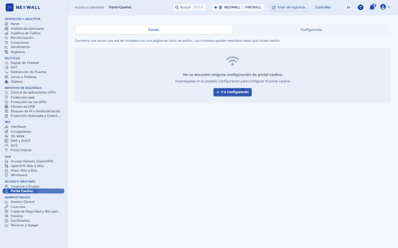

# Cómo convertir una red en red de invitados con página de acceso (Portal cautivo)

La unidad se conecta a un gestor remoto de portal cautivo que ofrece la página de acceso y las cuentas. La unidad aplica el acceso de cada invitado.

**Dónde:** **Acceso e Identidad** > **Portal Cautivo**

## Antes de empezar

- La dirección y una cuenta de administrador de su gestor de portal cautivo.
- Una interfaz libre o VLAN para la red de invitados ([Cómo configurar una interfaz de red (WAN, LAN, VLAN)](../network/interface.md)).

## Pasos

1. Abra la página y la pestaña **Configuración**.

   

2. En **Iniciar sesión** introduzca el **Endpoint del gestor de portal cautivo**, el **Usuario** y la **Contraseña** del gestor.
3. En **Configuración del portal cautivo** escriba el **Nombre de la unidad de portal cautivo** y la descripción. Elija el **Dispositivo de red** y defina la **Dirección de red** y los límites DHCP (o use el rango DHCP por defecto).
4. Haga clic en **Guardar y confirmar**: se aplican los cambios pendientes del firewall.
5. Abra la pestaña **Estado**: las sesiones de invitados aparecen con su MAC, IP, estado de acceso, tiempo de sesión y tráfico.

## Compruebe que funciona

- Un dispositivo invitado que se conecta es redirigido a la página de acceso y, tras iniciar sesión, aparece como **Autenticado**.

## Si no funciona

- Sin dispositivo disponible: cree antes la interfaz (**Ir a Interfaces**).
- Use **Anular registro** para desvincular la unidad del gestor.

## Guías relacionadas

- [Cómo configurar una interfaz de red (WAN, LAN, VLAN)](../network/interface.md)
- [Cómo crear una zona y definir su política](../policy/zone.md)
