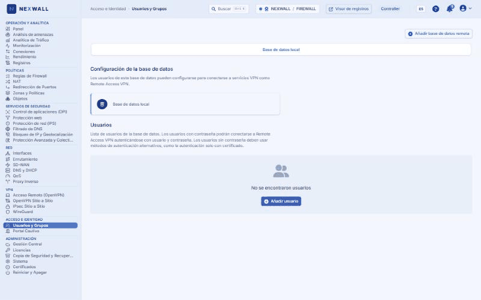

# Cómo crear usuarios y conectar un directorio (LDAP / Active Directory)

La base de usuarios la usan los servidores VPN. Puede mantener los usuarios localmente o leerlos de su directorio.

**Dónde:** **Acceso e Identidad** > **Usuarios y Grupos**

## Pasos

1. Abra la página.

   

2. Para un usuario local haga clic en **Añadir usuario**, escriba el **Usuario**, el **Nombre para mostrar** y una **Contraseña** segura (mínimo 8 caracteres, mayúsculas y minúsculas, un número y un carácter especial). Guarde.
3. Para que un usuario administre el firewall use **Establecer como usuario administrador** en el menú de la fila.
4. Para leer usuarios de un directorio haga clic en **Añadir base de datos remota** y elija **Active Directory remoto** o **LDAP remoto (RFC 2307)**. Rellene el **Nombre de la base de datos**, el **URI de LDAP**, el **DN base** y el **DN de bind** con su **Contraseña de bind**.
5. Haga clic en **Probar**: debe ver **Conexión verificada** y el número de usuarios encontrados. Guarde.
6. Seleccione la base en el servidor VPN ([Cómo permitir que los usuarios se conecten desde casa (acceso remoto OpenVPN)](../vpn/openvpn-remote-access.md)).

## Compruebe que funciona

- Los usuarios aparecen en la lista. Un inicio de sesión VPN con ese usuario funciona.

## Si no funciona

- La prueba del directorio falla: URI LDAP, puerto 636 con verificación del certificado, DNS y la cuenta de enlace. Pruebe `nc -vz <servidor> 636` en la consola.

## Guías relacionadas

- [Cómo permitir que los usuarios se conecten desde casa (acceso remoto OpenVPN)](../vpn/openvpn-remote-access.md)
- [Cómo configurar WireGuard (servidor con pares o túnel de par)](../vpn/wireguard.md)
