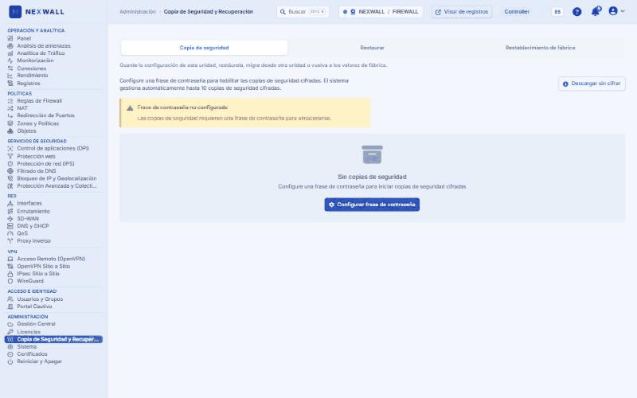

# Cómo hacer copia de seguridad y restaurar la configuración

Una copia contiene toda la configuración. Haga una antes de cada cambio importante.

**Dónde:** **Administración** > **Copia de Seguridad y Recuperación**

## Pasos

1. Abra la página, pestaña **Copia de seguridad**.

   

2. Haga clic en **Configurar frase de contraseña** y defina una contraseña de cifrado. Guárdela bien: es necesaria para restaurar.
3. Haga clic en **Descargar copia de seguridad** para guardar un archivo cifrado en su equipo, o **Ejecutar copia de seguridad en la nube** para enviarlo a la nube (suscripción).
4. Para restaurar abra la pestaña **Restaurar**, elija el archivo (o una copia en la nube), introduzca la contraseña y confirme. La unidad se reinicia.
5. Para llevar la configuración a una unidad nueva use la pestaña **Migración**.

## Compruebe que funciona

- La copia aparece en **Copias de seguridad** con fecha y tamaño. Tras restaurar, las reglas y redes están de vuelta.

## Si no funciona

- Contraseña perdida: la copia cifrada no se puede abrir. Guárdela en el gestor de contraseñas.
- La pestaña **Restablecimiento de fábrica** borra todo: úsela solo para empezar de cero.

## Guías relacionadas

- [Cómo actualizar el firewall (ahora o programado)](update.md)
- [Cómo registrar la licencia y revisar la suscripción](licensing.md)
