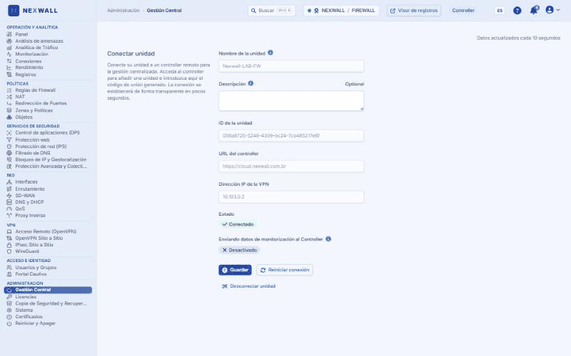

# Cómo conectar el firewall al Cloud Controller

La gestión central conecta la unidad a un controlador mediante un túnel seguro para acceso remoto, monitorización y gestión de grupos.

**Dónde:** **Administración** > **Gestión Central**

## Antes de empezar

- La dirección del controlador y un código de unión generado en el controlador.
- Acceso a internet saliente desde el firewall.

## Pasos

1. Abra la página y haga clic en **Conectar unidad**.

   

2. Rellene la **URL del controller** y el **Código de unión al controller**. Mantenga **Verificar certificado TLS** activado.
3. Haga clic en **Conectar unidad**. El estado pasa de **Pendiente** a **Conectado**.
4. En el controlador, la unidad aparece en la lista con su nombre y dirección VPN.

## Compruebe que funciona

- La página muestra **Conectado**, la **Dirección IP de la VPN** y la última vez que se enviaron datos.

## Si no funciona

- Se queda pendiente: código caducado o salida bloqueada. Vea [Controller registration troubleshooting](../../help/controller-registration-troubleshooting.md).
- Use **Reiniciar conexión** para reconectar o **Desconectar unidad** para salir del controlador.

## Guías relacionadas

- [Cómo registrar la licencia y revisar la suscripción](licensing.md)
