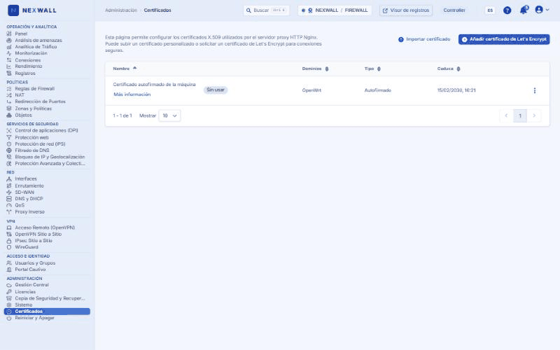

# Cómo instalar un certificado web de confianza (Let's Encrypt o importado)

El certificado de fábrica es autofirmado y los navegadores avisan. Un certificado de confianza elimina el aviso y es necesario para algunos servicios.

**Dónde:** **Administración** > **Certificados**

## Antes de empezar

- Un nombre DNS que apunte a la dirección pública del firewall (o una API DNS para validar).
- Para Let's Encrypt, el puerto TCP 80 accesible con el método Standalone.

## Pasos

1. Abra la página.

   

2. Para Let's Encrypt haga clic en **Añadir certificado de Let's Encrypt**: escriba el **Nombre del certificado**, añada el **Dominio** y elija el **Método de validación** (**Standalone**, **DNS** o **API de DNS**). Haga clic en **Añadir certificado**.
3. Para usar su propio certificado haga clic en **Importar certificado**: elija el archivo **Certificado**, la **Clave privada** y, si la tiene, la **Archivo de cadena**.
4. En la fila del certificado use **Establecer como predeterminado** para usarlo en la interfaz web.

## Compruebe que funciona

- La fila del certificado muestra los dominios y su fecha de **Caduca**, y el navegador muestra el candado.

## Si no funciona

- La validación falla: puerto 80 bloqueado o el nombre no apunta al firewall.
- Persisten los avisos: [KBA-25](../../help/kba-25-web-certificate.md).

## Guías relacionadas

- [Cómo publicar una aplicación web con el proxy inverso](../network/reverse-proxy.md)
- [Cómo definir el nombre de host, la zona horaria y NTP](system-settings.md)
