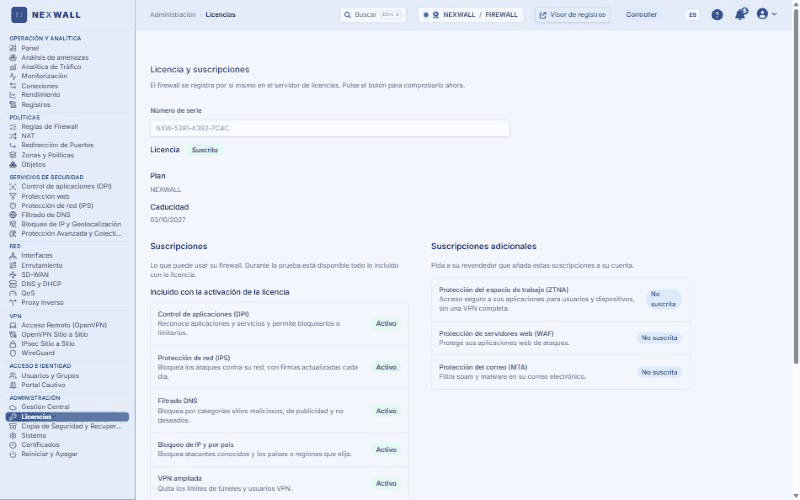

# Cómo registrar la licencia y revisar la suscripción

La unidad se registra en el servidor de licencias. Una suscripción desbloquea el catálogo ampliado de aplicaciones, las listas de bloqueo avanzadas, las actualizaciones automáticas, la copia remota y más.

**Dónde:** **Administración** > **Licencias**

## Pasos

1. Abra la página.

   

2. La página muestra el **Número de serie**, el estado del **Registro** (**Prueba: quedan \{days\} días**, **Suscrito** o **Sin licencia (funciones limitadas)**), el **Plan** y la **Caducidad**.
3. Si la unidad no está registrada, pegue el **Token de autenticación** que recibió y haga clic en **Registrar**.
4. Haga clic en **Sincronizar ahora** para refrescar el estado de inmediato.
5. La lista de funciones muestra cuáles están **Activo** en su plan.

## Compruebe que funciona

- El estado es **Suscrito** y las funciones del plan están activas.

## Si no funciona

- No sincroniza: el firewall necesita HTTPS saliente. Revise [KBA-26](../../help/kba-26-licensing.md).

## Guías relacionadas

- [Cómo conectar el firewall al Cloud Controller](central-management.md)
- [Cómo actualizar el firewall (ahora o programado)](update.md)
