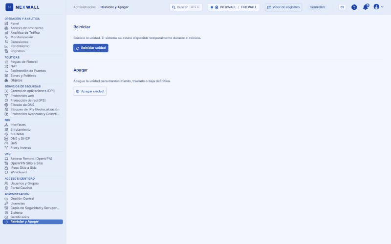

# Cómo reiniciar o apagar el firewall de forma segura

Use la interfaz web en lugar de cortar la energía: el sistema cierra los servicios y guarda el estado.

**Dónde:** **Administración** > **Reiniciar y Apagar**

## Pasos

1. Abra la página.

   

2. Haga clic en **Reiniciar unidad** para reiniciar o **Apagar unidad** para apagar.
3. Lea el aviso. Si hay cambios sin guardar, se perderán: aplíquelos o descártelos antes.
4. Confirme con **Reiniciar ahora**. Espere el mensaje de reinicio completado; la página se recarga sola.

## Compruebe que funciona

- El panel muestra un **Tiempo activo** corto tras el reinicio.

## Si no funciona

- No vuelve: espere hasta cinco minutos; si sigue sin volver, use la consola de la VM.

## Guías relacionadas

- [Cómo actualizar el firewall (ahora o programado)](update.md)
- [Cómo hacer copia de seguridad y restaurar la configuración](backup-restore.md)
