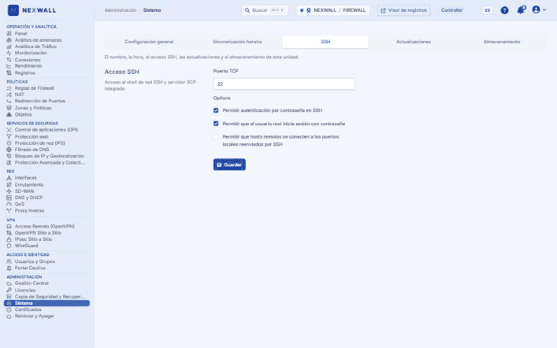

# Cómo gestionar el acceso SSH

SSH es la puerta a la línea de comandos que usan las KBAs. Restrinja quién puede llegar a él.

**Dónde:** **Administración** > **Sistema**

## Pasos

1. Abra **Sistema** y elija la pestaña **SSH**.

   

2. En **Acceso SSH** defina el **Puerto TCP** si quiere uno distinto del 22.
3. Decida sobre **Permitir autenticación por contraseña en SSH** y **Permitir que el usuario root inicie sesión con contraseña**. Si solo necesitan acceso administradores de confianza, desactive las contraseñas.
4. Guarde y aplique. Mantenga abierta su sesión actual y pruebe una nueva antes de cerrarla.

## Compruebe que funciona

- `ssh root@<firewall>` en el puerto configurado abre una shell.

## Si no funciona

- Bloqueado: use la consola de la VM o el terminal remoto del controlador.
- SSH accesible desde internet: restríngalo con una regla de entrada ([Cómo permitir o bloquear tráfico con una regla de firewall](../policy/firewall-rule.md)).

## Guías relacionadas

- [Cómo definir el nombre de host, la zona horaria y NTP](system-settings.md)
- [Cómo permitir o bloquear tráfico con una regla de firewall](../policy/firewall-rule.md)
