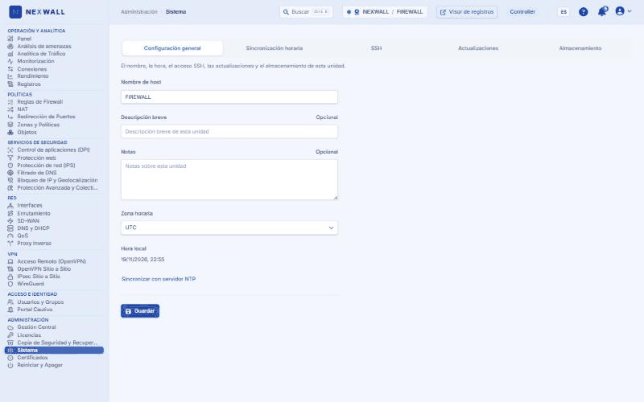

# Cómo definir el nombre de host, la zona horaria y NTP

Un reloj correcto importa para los registros, certificados, VPN y licencias.

**Dónde:** **Administración** > **Sistema**

## Pasos

1. Abra la página. La primera pestaña muestra **Configuración general**.

   

2. Escriba el **Nombre de host** y, opcionalmente, **Notas** sobre la unidad.
3. Elija la **Zona horaria**. En **Sincronización horaria** mantenga **Activar cliente NTP** activado y añada su propio **Añadir servidor NTP** si lo tiene.
4. Para que la LAN use el firewall como servidor de hora active **Proporcionar servidor NTP** y elija la interfaz.
5. Guarde. Las pestañas **SSH**, **Actualizaciones** y **Almacenamiento** están en la misma página ([Cómo gestionar el acceso SSH](ssh.md), [Cómo actualizar el firewall (ahora o programado)](update.md)).

## Compruebe que funciona

- **Hora local** coincide con su reloj.

## Si no funciona

- Hora incorrecta tras reiniciar: NTP bloqueado. Permita UDP 123 hacia internet o use un servidor local.

## Guías relacionadas

- [Cómo gestionar el acceso SSH](ssh.md)
- [Cómo actualizar el firewall (ahora o programado)](update.md)
