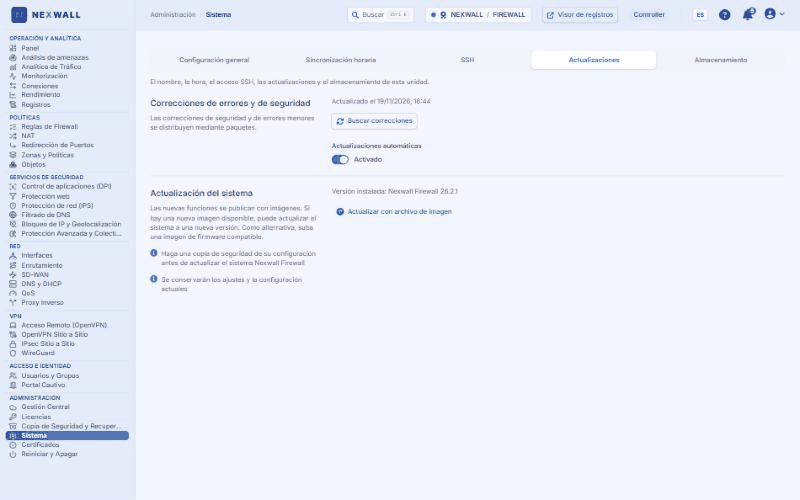

# Cómo actualizar el firewall (ahora o programado)

Las actualizaciones conservan su configuración. Haga siempre una copia antes ([Cómo hacer copia de seguridad y restaurar la configuración](backup-restore.md)).

**Dónde:** **Administración** > **Sistema**

## Pasos

1. Abra **Sistema** y elija la pestaña **Actualizaciones**.

   

2. La página muestra la **Versión instalada: \{release\}** y si hay una versión nueva. Haga clic en **Buscar correcciones** para refrescar.
3. Cuando aparezca **Nueva versión disponible**, haga clic en **Actualizar a la versión**. En **Elija cuándo actualizar** elija **Ahora** o **Programar fecha y hora** y escoja un momento tranquilo.
4. Confirme con **Actualizar y reiniciar**. La unidad se reinicia; la interfaz web vuelve en unos minutos.
5. Para una unidad sin internet use **Actualizar con archivo de imagen** y elija el archivo de imagen.
6. Para instalar correcciones automáticamente active **Actualizaciones automáticas**.

## Compruebe que funciona

- La versión instalada es la nueva y el panel muestra los servicios en marcha.

## Si no funciona

- Falla la actualización: revise espacio y conectividad, vea [KBA-0010](../../help/kba-10-updates.md).
- Tras la actualización algo falla: restaure la copia ([Cómo hacer copia de seguridad y restaurar la configuración](backup-restore.md)).

## Guías relacionadas

- [Cómo hacer copia de seguridad y restaurar la configuración](backup-restore.md)
- [Cómo registrar la licencia y revisar la suscripción](licensing.md)
