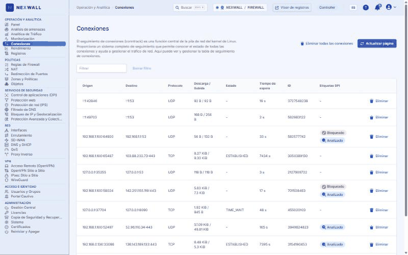

# Cómo ver y cortar conexiones activas

La página Conexiones muestra la tabla de seguimiento del kernel: cada conexión que el firewall sigue, con su estado y el resultado de DPI.

**Dónde:** **Operación y Analítica** > **Conexiones**

## Pasos

1. Abra **Conexiones**.

   

2. Lea las columnas **Origen**, **Destino**, **Protocolo**, **Descarga** / **Subida**, **Estado** y **Tiempo de espera**. La columna **Etiquetas DPI** muestra **Analizado** o **Bloqueado**.
3. Escriba una dirección en el filtro para aislar un dispositivo o destino.
4. Para terminar una conexión haga clic en **Eliminar conexión** en su fila y confirme. El cliente se reconecta, ya bajo las reglas actuales.
5. Haga clic en **Actualizar página** para actualizar la lista.

## Compruebe que funciona

- Tras cambiar una regla, eliminar la conexión antigua hace que la regla nueva se aplique a ella.

## Si no funciona

- **Eliminar todas las conexiones** corta todas las conexiones, incluida su propia sesión: úselo solo en una ventana de mantenimiento.

## Guías relacionadas

- [Cómo ver quién usa la red (Traffic Analytics)](traffic-analytics.md)
- [Cómo permitir o bloquear tráfico con una regla de firewall](../policy/firewall-rule.md)
