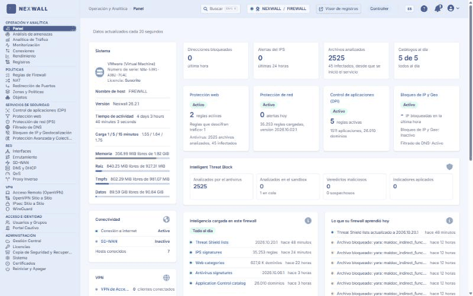

# Cómo leer el panel

El panel es la primera página tras iniciar sesión. Muestra de un vistazo si la unidad está sana.

**Dónde:** **Operación y Analítica** > **Panel**

## Pasos

1. Abra **Panel**.

   

2. En **Sistema** revise el **Nombre de host**, el **Número de serie**, la **Licencia**, la **Versión** y el **Tiempo de actividad**. Un tiempo activo muy corto indica un reinicio reciente.
3. Mire **Carga 1 / 5 / 15 minutos**: valores por encima del número de núcleos durante mucho tiempo indican sobrecarga.
4. Revise las tarjetas de estado de los servicios (**SD-WAN**, **DPI-core**, **Portal Cautivo**, **Bloqueo de IP y Geo**, **VPN de Acceso Remoto**): **Activo**, **Inactivo** o **Advertencia**.
5. En **Tráfico de la WAN** elija la **Interfaz WAN** y lea las tasas de **Descargar** y **Subir**.
6. Revise **Memoria**, **Raíz** y **Datos**: manténgalos lejos del límite.

## Compruebe que funciona

- Todos los servicios que usa están **Activo** y el almacenamiento no está lleno.

## Si no funciona

- Aviso por el nombre de host predeterminado: cámbielo ([Cómo definir el nombre de host, la zona horaria y NTP](../admin/system-settings.md)).
- Un servicio está **Inactivo**: abra su página y lea el mensaje.

## Guías relacionadas

- [Cómo buscar en los registros](logs.md)
- [Cómo ver quién usa la red (Traffic Analytics)](traffic-analytics.md)
