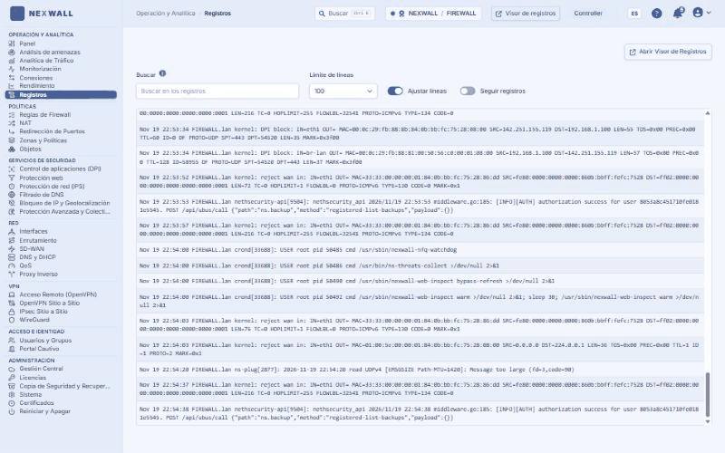

# Cómo buscar en los registros

Los registros son el primer lugar donde mirar cuando algo no funciona.

**Dónde:** **Operación y Analítica** > **Registros**

## Pasos

1. Abra **Registros** y haga clic en **Abrir Visor de Registros**.

   

2. Defina el **Límite de líneas** que quiere ver y active **Seguir registros** para ver llegar las líneas nuevas.
3. Escriba en **Buscar** una palabra, una dirección IP o una expresión regular (por ejemplo `192.168.1.50|dropped`).
4. Active **Ajustar líneas** para leer líneas largas sin desplazarse hacia los lados.

## Compruebe que funciona

- Solo se muestran las líneas que coinciden con su búsqueda.

## Si no funciona

- Mensaje de expresión regular no válida: escape caracteres especiales como `.` o `(`.
- Sin eventos del firewall: active el registro en la regla ([Cómo permitir o bloquear tráfico con una regla de firewall](../policy/firewall-rule.md)).

## Guías relacionadas

- [Cómo leer el panel](dashboard.md)
- [Cómo permitir o bloquear tráfico con una regla de firewall](../policy/firewall-rule.md)
