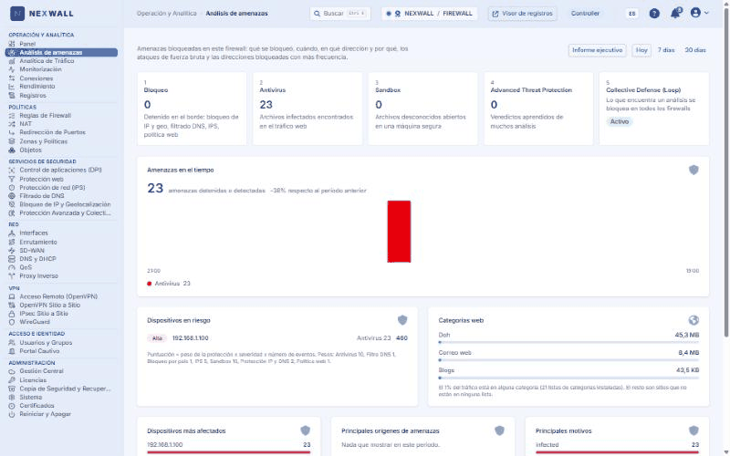

# Cómo revisar las amenazas detenidas y los dispositivos en riesgo

Threat Analytics reúne lo que cada protección detuvo o detectó, para saber si un dispositivo necesita atención.

**Dónde:** **Operación y Analítica** > **Análisis de amenazas**

## Pasos

1. Abra **Análisis de amenazas**.

   

2. Elija el periodo. **Amenazas en el tiempo** muestra cuántas amenazas se detuvieron o detectaron, frente al periodo anterior.
3. Las etapas **Bloqueo**, **Antivirus**, **Sandbox** y **Advanced Threat Protection** muestran qué protecciones están **Activo** o **No activado**.
4. En **Dispositivos en riesgo** vea los dispositivos con mayor puntuación y su **Severidad**.
5. Abajo, la tabla **Eventos** lista cada evento; filtre por **Protección** o busque un dispositivo o dirección.

## Compruebe que funciona

- Puede nombrar el dispositivo con más eventos y la protección que los detuvo.

## Si no funciona

- No aparece nada: confirme que las protecciones están activas ([Cómo activar la prevención de intrusiones (IPS)](../security/ips.md), [Cómo bloquear dominios maliciosos (Filtrado de DNS)](../security/dns-filtering.md), [Cómo bloquear direcciones IP y países maliciosos (Bloqueo de IP y Geolocalización)](../security/ip-geo-blocking.md)) y que el registro está habilitado.

## Guías relacionadas

- [Cómo activar la Protección avanzada y colectiva](../security/atp.md)
- [Cómo activar la prevención de intrusiones (IPS)](../security/ips.md)
- [Cómo ver quién usa la red (Traffic Analytics)](traffic-analytics.md)
