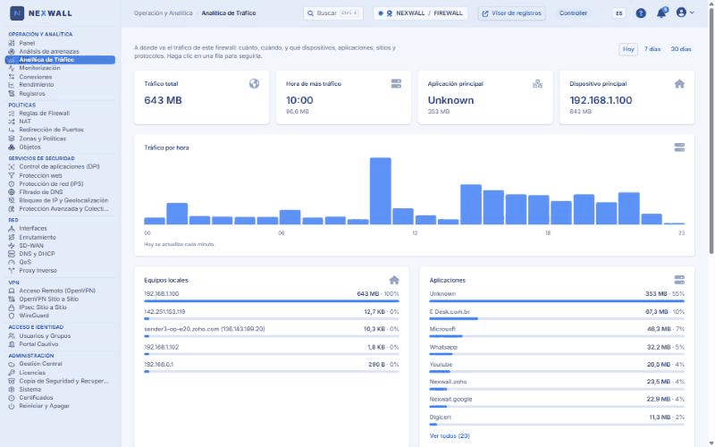

# Cómo ver quién usa la red (Traffic Analytics)

Traffic Analytics responde adónde va el tráfico: cuánto, cuándo y qué dispositivos, aplicaciones, hosts remotos y protocolos.

**Dónde:** **Operación y Analítica** > **Analítica de Tráfico**

## Pasos

1. Abra **Analítica de Tráfico**.

   

2. Elija el periodo arriba. Las tarjetas muestran **Tráfico total**, **Hora de más tráfico**, **Aplicación principal** y **Dispositivo principal**.
3. Debajo, las listas **Equipos locales**, **Aplicaciones**, **Equipos remotos** y **Protocolos** ordenan el tráfico.
4. Haga clic en una fila para filtrar todo por ella (por ejemplo un dispositivo) y ver qué aplicaciones usa. Use **Quitar** para volver.

## Compruebe que funciona

- Los gráficos y listas cambian al seleccionar un dispositivo o aplicación.

## Si no funciona

- Página vacía: el motor DPI debe estar activo ([Cómo bloquear aplicaciones y protocolos (Control de aplicaciones)](../security/app-control.md)). Los datos de hoy se actualizan cada minuto.

## Guías relacionadas

- [Cómo ver y cortar conexiones activas](connections.md)
- [Cómo revisar las amenazas detenidas y los dispositivos en riesgo](threat-analytics.md)
