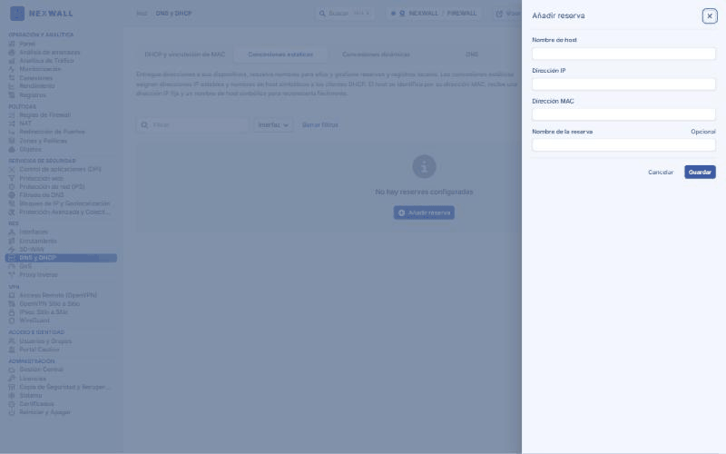

# Cómo reservar una dirección IP fija para un dispositivo

Una reserva vincula una dirección MAC con una dirección IP y un nombre de host. Los servidores que publique con una redirección de puertos deberían tener una.

**Dónde:** **Red** > **DNS y DHCP**

## Pasos

1. Abra la página y elija la pestaña **Concesiones estáticas**.

   

2. Haga clic en **Añadir reserva**.
3. Rellene el **Nombre de host**, la **Dirección IP** (fuera del rango dinámico o dentro, pero sin usar por otro host) y la **Dirección MAC**. El **Nombre de la reserva** es opcional. Haga clic en **Guardar**.
4. Para encontrar la MAC de un dispositivo conectado abra la pestaña **Concesiones dinámicas** o ejecute **Escanear red** en la pestaña **Escanear red**; el resultado permite reservar con un clic.
5. Renueve la dirección en el dispositivo (desconecte y reconecte el cable o ejecute `ipconfig /renew`).

## Compruebe que funciona

- La reserva aparece en la lista y el dispositivo recibe esa dirección.

## Si no funciona

- El dispositivo conserva la dirección anterior: espere a que caduque la concesión o renuévela en el dispositivo.
- Una reserva creada aquí también aparece como nombre DNS; vea [Cómo definir servidores DNS y nombres DNS locales](dns-record.md).

## Guías relacionadas

- [Cómo activar y ajustar el servidor DHCP](dhcp-server.md)
- [Cómo publicar un servidor interno (redirección de puertos)](../policy/port-forward.md)
