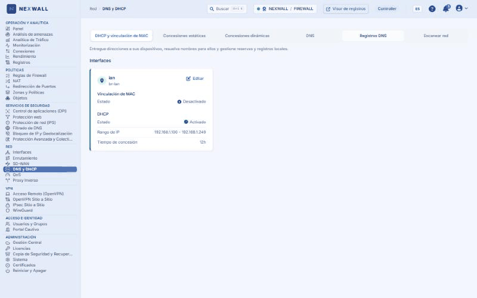

# Cómo activar y ajustar el servidor DHCP

La primera pestaña, **DHCP y vinculación de MAC**, muestra cada interfaz con su estado DHCP, rango de direcciones y tiempo de concesión.

**Dónde:** **Red** > **DNS y DHCP**

## Pasos

1. Abra la página. En la tarjeta de la interfaz haga clic en **Editar \{interface\}**.

   

2. Active **Activar DHCP**. Rellene **IP inicial del rango**, **IP final del rango** y el **Tiempo de concesión**.
3. Abra **Configuración avanzada** para definir la **IP de la puerta de enlace**, el **Dominio** o añadir una **Opción DHCP** (por ejemplo la opción 66 para un servidor de aprovisionamiento).
4. Para aceptar solo dispositivos conocidos active la vinculación de MAC y elija **Vinculación estricta**: solo los hosts con reserva reciben dirección ([Cómo reservar una dirección IP fija para un dispositivo](dhcp-reservation.md)). **Vinculación flexible** permite hosts sin reserva pero bloquea una dirección reservada usada por otra MAC.
5. Guarde.

## Compruebe que funciona

- La tarjeta muestra DHCP **Activo** y el rango.
- Un cliente con dirección automática recibe una dirección del rango. Las concesiones dinámicas están en la pestaña **Concesiones dinámicas**.

## Si no funciona

- Sin ofertas: confirme que la interfaz tiene una dirección en la misma red ([Cómo configurar una interfaz de red (WAN, LAN, VLAN)](interface.md)).
- Otro servidor DHCP en la red: solo uno debe responder. Use `tcpdump -ni br-lan port 67 or port 68` en la consola.

## Guías relacionadas

- [Cómo reservar una dirección IP fija para un dispositivo](dhcp-reservation.md)
- [Cómo definir servidores DNS y nombres DNS locales](dns-record.md)
