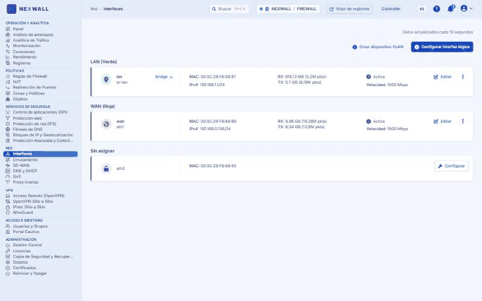

# Cómo configurar una interfaz de red (WAN, LAN, VLAN)

La página lista cada puerto con su zona, dirección MAC, contadores de tráfico y velocidad de enlace. Los puertos sin usar aparecen en **Sin asignar**.

**Dónde:** **Red** > **Interfaces**

## Antes de empezar

- Planifique la zona y la dirección de la nueva red. Cree antes una zona personalizada si hace falta ([Cómo crear una zona y definir su política](../policy/zone.md)).
- No cambie la interfaz por la que accede a la interfaz web o perderá la sesión.

## Pasos

1. Abra la página.

   

2. En un puerto sin asignar haga clic en **Configurar**. Para crear un bridge o usar un dispositivo existente, haga clic en **Configurar interfaz lógica**.
3. Escriba el **Nombre de la interfaz** y elija la **Zona** (**LAN (Verde)**, **WAN (Roja)**, **GUEST (Azul)**, **DMZ (Naranja)** o **Personalizado**).
4. Elija el **Protocolo**: **Estático**, cliente DHCP o PPPoE (rellene **Usuario** y **Contraseña**).
5. Para una dirección estática rellene **Dirección IPv4**, **Máscara de subred IPv4** y, en una WAN, la **Puerta de enlace IPv4**.
6. Guarde con **Configurar interfaz**. Para una VLAN haga clic en **Crear dispositivo VLAN**, elija el **Dispositivo base**, el **ID de VLAN** (1 a 4094) y haga clic en **Crear dispositivo**; luego configure el nuevo dispositivo como arriba.
7. Para añadir una segunda dirección a un puerto use **Crear interfaz de alias** en el menú ⋮ de la fila.

## Compruebe que funciona

- La fila muestra **Activa** con la nueva dirección.
- Haga ping a la nueva puerta de enlace desde un cliente de la red o use [KBA-14](../../help/kba-14-connectivity.md).

## Si no funciona

- El enlace aparece como **Inactiva**: revise el cable y el puerto del switch; `ethtool eth2` en la consola.
- Los clientes no obtienen dirección: active DHCP en la interfaz ([Cómo activar y ajustar el servidor DHCP](dhcp-server.md)).
- Quite la configuración de un puerto con **Quitar configuración** en el menú ⋮.

## Guías relacionadas

- [Cómo crear una zona y definir su política](../policy/zone.md)
- [Cómo activar y ajustar el servidor DHCP](dhcp-server.md)
- [Cómo añadir una ruta estática](route.md)
