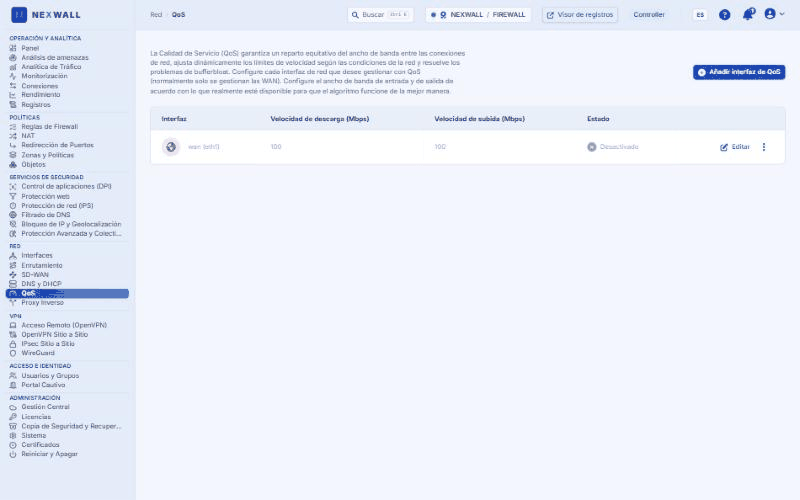

# Cómo limitar y repartir el ancho de banda (QoS)

QoS mantiene baja la latencia cuando el enlace está lleno. Necesita la velocidad real del enlace.

**Dónde:** **Red** > **QoS**

## Antes de empezar

- Mida la velocidad del enlace con la **prueba de velocidad** del panel o `speedtest` en la consola.

## Pasos

1. Abra la página.

   

2. Haga clic en **Añadir interfaz de QoS** (o **Editar** en la fila de la WAN).
3. Elija la **Interfaz** (normalmente la WAN) e introduzca la **Velocidad de descarga** y la **Velocidad de subida** en Mbps. Use entre el 90 y el 95 por ciento de la velocidad medida.
4. Active el **Estado** y guarde.

## Compruebe que funciona

- La fila muestra el estado **Activado**. Haga una prueba de velocidad mientras descarga un archivo grande: el ping se mantiene bajo.

## Si no funciona

- Velocidad menor de la esperada: suba los valores en pasos pequeños.
- Enlace lento con fast-path activo: vea [KBA-18](../../help/kba-18-fast-path.md).

## Guías relacionadas

- [Cómo usar dos enlaces de internet (failover o balanceo)](sd-wan.md)
- [Cómo bloquear aplicaciones y protocolos (Control de aplicaciones)](../security/app-control.md)
