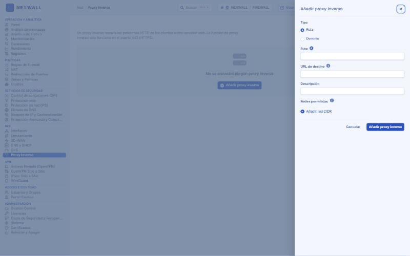

# Cómo publicar una aplicación web con el proxy inverso

El proxy inverso escucha en el puerto TCP 443 del firewall y reenvía las peticiones a servidores web internos, usando un certificado del firewall.

**Dónde:** **Red** > **Proxy Inverso**

## Antes de empezar

- El puerto TCP 443 debe ser accesible desde donde vienen los usuarios (una regla o el acceso directo **Ir a reglas de firewall** de la página).
- Si usa un dominio, un certificado de confianza para él ([Cómo instalar un certificado web de confianza (Let's Encrypt o importado)](../admin/certificate.md)).

## Pasos

1. Abra la página y haga clic en **Añadir proxy inverso**.

   

2. Elija el **Tipo**: **Ruta** (por ejemplo `/app`) o **Dominio** (un nombre de host).
3. Rellene la **URL de destino**, por ejemplo `http://192.168.1.50:8080`, y una **Descripción**.
4. Para limitar quién puede usarlo haga clic en **Añadir red CIDR** e introduzca las redes permitidas. Elija el **Certificado** cuando el tipo es dominio.
5. Haga clic en **Añadir proxy inverso**.

## Compruebe que funciona

- Abra `https://<dirección-del-firewall>/app` desde una red permitida y la aplicación carga.

## Si no funciona

- Tiempo de espera desde fuera: el puerto 443 no está abierto, vea el aviso en la parte superior de la página.
- Una aplicación con enlaces absolutos no funciona bajo una ruta: use un dominio.

## Guías relacionadas

- [Cómo instalar un certificado web de confianza (Let's Encrypt o importado)](../admin/certificate.md)
- [Cómo publicar un servidor interno (redirección de puertos)](../policy/port-forward.md)
