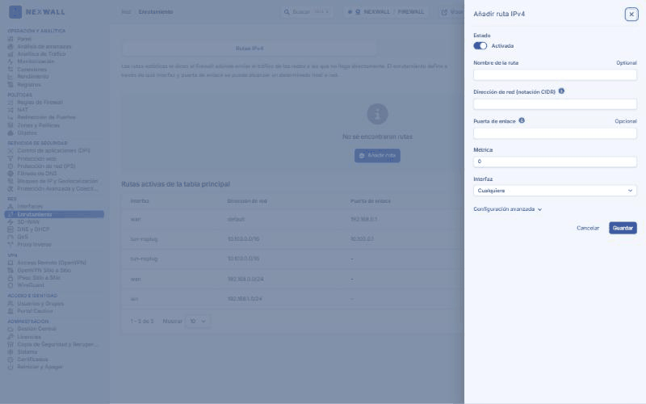

# Cómo añadir una ruta estática

Use una ruta estática cuando otro router conecta una red remota, por ejemplo una sucursal accesible a través de un router de la LAN.

**Dónde:** **Red** > **Enrutamiento**

## Antes de empezar

- Conozca la red remota (CIDR) y la puerta de enlace en una red que el firewall ya alcanza.

## Pasos

1. Abra la página y haga clic en **Añadir ruta** en la pestaña **Rutas IPv4**.

   

2. Rellene **Nombre de la ruta** (opcional) y **Dirección de red (notación CIDR)**, por ejemplo `10.20.0.0/24`.
3. Rellene la **Puerta de enlace** con la dirección del siguiente router y elija la **Interfaz** o déjela en Cualquiera.
4. Defina la **Métrica** si hay más de una ruta a la misma red (gana la menor). Haga clic en **Guardar**.
5. Cree una [Cómo permitir o bloquear tráfico con una regla de firewall](../policy/firewall-rule.md) si el tráfico cruza zonas.

## Compruebe que funciona

- La ruta aparece en **Rutas activas de la tabla principal**.
- Desde un cliente de la LAN, haga `ping` a un host de la red remota.

## Si no funciona

- La ruta no se usa: la puerta de enlace debe estar en una red conectada directamente.
- Las respuestas no vuelven: el host remoto necesita una ruta de vuelta a su LAN.

## Guías relacionadas

- [Cómo configurar una interfaz de red (WAN, LAN, VLAN)](interface.md)
- [Cómo permitir o bloquear tráfico con una regla de firewall](../policy/firewall-rule.md)
