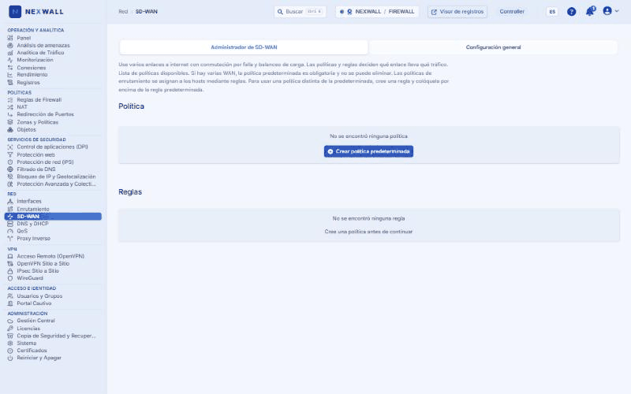

# Cómo usar dos enlaces de internet (failover o balanceo)

Con dos o más enlaces WAN el administrador SD-WAN decide qué enlace lleva qué tráfico. La política predeterminada es obligatoria.

**Dónde:** **Red** > **SD-WAN**

## Antes de empezar

- Ambos puertos WAN están configurados como interfaces de la zona WAN ([Cómo configurar una interfaz de red (WAN, LAN, VLAN)](interface.md)).

## Pasos

1. Abra la página.

   

2. Haga clic en **Crear política predeterminada**. En **Elegir comportamiento** elija **Respaldo** (un enlace en uso, el otro espera) o **Balanceo** (ambos en uso).
3. Añada cada puerta de enlace con **Añadir gateway**. En modo respaldo ordénelas por prioridad; en balanceo defina el **Peso** de cada una.
4. Abra la pestaña **Configuración general**. En **Monitorización de WAN** añada direcciones fiables a las que hacer ping, por ejemplo `1.1.1.1` y `8.8.8.8`. Ajuste **Configuración de ping** solo si hace falta.
5. Para enviar tráfico específico por un enlace concreto haga clic en **Crear nueva regla**: póngale nombre, elija la **Política asignada** y el origen, destino, protocolo y puertos. Las reglas se evalúan en orden; la política predeterminada va al final.

## Compruebe que funciona

- La política muestra ambos enlaces activos. Desconecte el principal: el tráfico cambia dentro del tiempo de detección y el evento queda en **Registros**.

## Si no funciona

- Los enlaces oscilan: la dirección de monitorización puede bloquear ping. Use dos direcciones distintas.
- Se cortan sesiones en balanceo: use **Sticky** en la regla para sitios que atan la sesión a la dirección de origen.

## Guías relacionadas

- [Cómo configurar una interfaz de red (WAN, LAN, VLAN)](interface.md)
- [Cómo leer el panel](../monitor/dashboard.md)
