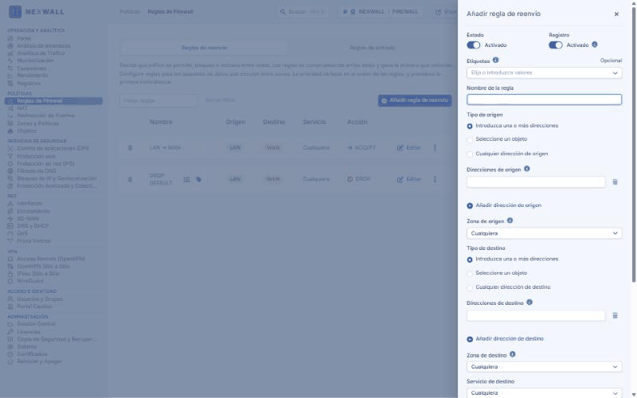

# Cómo permitir o bloquear tráfico con una regla de firewall

Las reglas de firewall deciden qué tráfico se acepta, descarta o rechaza. Se evalúan de arriba abajo y gana la primera coincidencia, por lo que la posición importa.

**Dónde:** **Políticas** > **Reglas de Firewall**

## Antes de empezar

- Conozca la **zona de origen** y la **zona de destino** del tráfico (vea [Cómo crear una zona y definir su política](zone.md)).
- Decida la acción: **Aceptar** lo deja pasar, **Descartar** lo elimina en silencio, **Rechazar** lo elimina e informa al emisor.

## Pasos

1. Abra la página y elija la pestaña: **Reglas de reenvío** (tráfico entre zonas), **Reglas de entrada** (tráfico hacia el propio firewall) o **Reglas de salida** (tráfico que inicia el firewall).
2. Haga clic en **Añadir regla de reenvío** (o en el botón de entrada/salida de la pestaña). Se abre un panel a la derecha.

   

3. Escriba un **Nombre de la regla** que explique lo que hace, por ejemplo `LAN a servidores HTTPS`.
4. En **Tipo de origen** introduzca las direcciones, elija un objeto o seleccione **Cualquier dirección de origen**. Seleccione la **Zona de origen**.
5. Haga lo mismo con el destino: **Tipo de destino** y **Zona de destino**.
6. Elija el **Servicio**. Con **Servicio personalizado** indique **Protocolos** y **Puertos**, por ejemplo `8081, 9090, 5500-5600`.
7. Elija la **Acción**.
8. Defina la **Posición de la regla**: **Añadir al principio** o **Añadir al final**. Una regla específica que deba ganar a una general va por encima de ella.
9. Deje **Registro** activado en las reglas que quiera auditar. Haga clic en **Guardar regla**.
10. Para cambiar el orden después, arrastre el asa a la izquierda de la fila. Use el menú ⋮ para **Duplicar** o **Eliminar regla** una regla.

## Compruebe que funciona

- La regla aparece en la lista y el panel **Reglas de un vistazo** la cuenta.
- Pruebe desde un cliente de la zona de origen. El registro de la regla (**Registros**) muestra la coincidencia si el registro está activado.

## Si no funciona

- La regla aparece como **Inactiva**: usa una zona que ya no existe o está desactivada. Edítela y elija una zona válida.
- El tráfico sigue bloqueado: una regla anterior coincide primero. Suba la suya.
- Sitio inaccesible desde un cliente: [KBA-0004](../../help/kba-04-site-unreachable.md).

## Guías relacionadas

- [Cómo crear una zona y definir su política](zone.md)
- [Cómo crear objetos reutilizables (conjuntos de hosts y de dominios)](object.md)
- [Cómo publicar un servidor interno (redirección de puertos)](port-forward.md)
