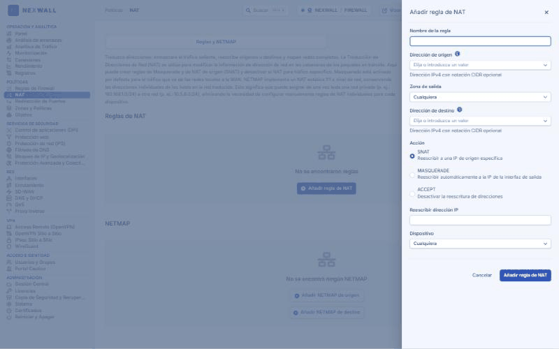

# Cómo crear una regla de NAT (enmascaramiento o NAT de origen)

El enmascaramiento ya está activo para la LAN. Cree una regla de NAT cuando necesite una dirección de origen fija, una distinta por red o ninguna traducción (por ejemplo entre dos sitios por un túnel).

**Dónde:** **Políticas** > **NAT**

## Antes de empezar

- Conozca la red de origen, la zona de salida y, para NAT de origen, la dirección pública a usar.

## Pasos

1. Abra la página y haga clic en **Añadir regla de NAT**.

   

2. Escriba el **Nombre de la regla**.
3. Rellene **Dirección de origen** y **Dirección de destino** (IPv4 con CIDR opcional) o deje **Cualquier dirección**. Elija la **Zona de salida**.
4. Elija la **Acción**: **Reescribir automáticamente a la IP de la interfaz de salida**; **Reescribir a una IP de origen específica** (luego indique la **Reescribir dirección IP**); o **Desactivar la reescritura de direcciones**.
5. Haga clic en **Guardar regla de NAT**.

## Compruebe que funciona

- La regla aparece en la lista. En la consola, `nft list ruleset | grep -i snat` o la lista de conexiones (**Conexiones**) muestra el origen traducido.

## Si no funciona

- El tráfico entre sitios no debe traducirse: añada una regla **Desactivar la reescritura de direcciones** por encima del enmascaramiento.
- Mismas direcciones en ambos sitios: use NETMAP (pestaña **Reglas y NETMAP**).

## Guías relacionadas

- [Cómo permitir o bloquear tráfico con una regla de firewall](firewall-rule.md)
- [Cómo crear un túnel IPsec con otro firewall o router](../vpn/ipsec-site-to-site.md)
