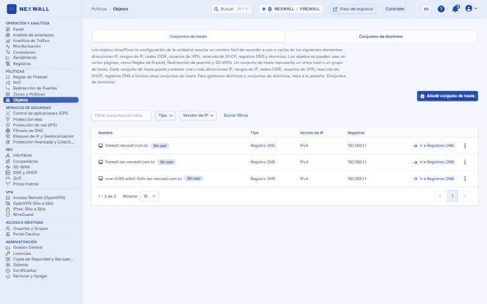

# Cómo crear objetos reutilizables (conjuntos de hosts y de dominios)

Los objetos hacen las reglas legibles y fáciles de mantener: cambie el objeto y todas las reglas que lo usan lo siguen.

**Dónde:** **Políticas** > **Objetos**

## Pasos

1. Abra la página. Elija la pestaña **Conjuntos de hosts** o **Conjuntos de dominios**.

   

2. Haga clic en **Añadir conjunto de hosts** (o **Añadir conjunto de dominios**). Escriba un **Nombre** solo con letras y números.
3. En un conjunto de hosts elija la **Versión de IP** y haga clic en **Añadir registro** por cada elemento: **Host**, **Red CIDR**, **Rango de IP**, **Reserva de DHCP** o **Registro DNS**. En un conjunto de dominios use **Añadir dominio**.
4. Haga clic en **Guardar conjunto de hosts** (o **Guardar conjunto de dominios**).
5. Use el objeto en una regla: en origen o destino elija **Seleccione un objeto**.

## Compruebe que funciona

- El objeto aparece en la lista. **Mostrar usos** indica dónde se usa.

## Si no funciona

- No se puede eliminar: el objeto está en uso. Quítelo antes de las reglas que indican los usos.
- Las redirecciones de puertos no aceptan rangos de IP ni objetos anidados.

## Guías relacionadas

- [Cómo permitir o bloquear tráfico con una regla de firewall](firewall-rule.md)
- [Cómo publicar un servidor interno (redirección de puertos)](port-forward.md)
