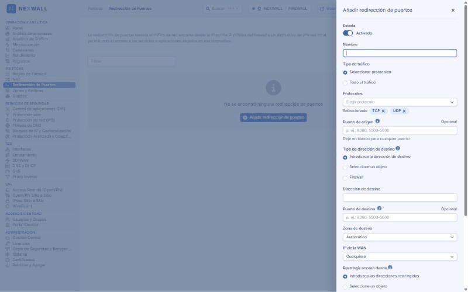

# Cómo publicar un servidor interno (redirección de puertos)

Una redirección de puertos publica un servicio, como un servidor web, que funciona en un host interno, usando la dirección pública del firewall.

**Dónde:** **Políticas** > **Redirección de Puertos**

## Antes de empezar

- El servidor interno tiene una dirección fija (use una reserva DHCP, vea [Cómo reservar una dirección IP fija para un dispositivo](../network/dhcp-reservation.md)).
- Conozca el puerto que usarán los clientes y el del servidor.

## Pasos

1. Abra la página y haga clic en **Añadir redirección de puertos**. Se abre un panel.

   

2. Escriba un **Nombre**, por ejemplo `Servidor web`.
3. En **Tipo de tráfico** mantenga **Seleccionar protocolos** y marque TCP, UDP o ambos en **Protocolos**. Evite **Todo el tráfico**: envía todo a un solo host.
4. Introduzca el **Puerto de origen** al que se conectan los clientes, por ejemplo `8080` o `5500-5600`.
5. En **Tipo de dirección de destino** introduzca la dirección del host interno o elija un objeto. Opcionalmente defina el **Puerto de destino**; si está vacío se usa el mismo puerto.
6. Elija la **Zona de destino** (**Automático** sirve en la mayoría de los casos) y la **IP de la WAN** si tiene más de una.
7. Para permitir solo a algunos clientes, rellene **Restringir acceso desde** con direcciones o redes. Por defecto puede conectarse cualquiera.
8. Active las zonas de **Hairpin NAT** si los usuarios internos deben llegar al servicio con el nombre público. Haga clic en **Guardar redirección de puertos**.

## Compruebe que funciona

- La fila muestra **Activado**.
- Desde internet, conéctese a la dirección pública y al puerto. Pruebe desde una red móvil, no desde su LAN.

## Si no funciona

- Funciona desde fuera pero no desde la LAN: active **Hairpin NAT** para la zona LAN.
- Sin respuesta: el firewall del servidor o su puerta de enlace. El servidor debe usar el firewall como puerta de enlace.
- Revise la ruta con [KBA-14](../../help/kba-14-connectivity.md).

## Guías relacionadas

- [Cómo permitir o bloquear tráfico con una regla de firewall](firewall-rule.md)
- [Cómo crear objetos reutilizables (conjuntos de hosts y de dominios)](object.md)
