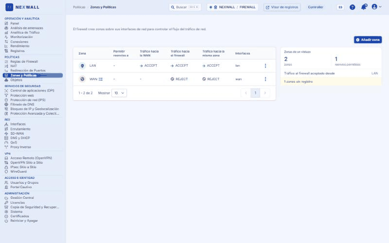

# Cómo crear una zona y definir su política

Una zona es un grupo de interfaces de red con el mismo nivel de confianza (LAN, WAN, Invitados, DMZ). La política de zona indica qué zonas pueden enviar tráfico a cuáles.

**Dónde:** **Políticas** > **Zonas y Políticas**

## Antes de empezar

- La interfaz de la nueva red existe (vea [Cómo configurar una interfaz de red (WAN, LAN, VLAN)](../network/interface.md)).

## Pasos

1. Abra la página. La matriz muestra cada zona con **Permitir reenvíos a**, **Tráfico hacia la WAN**, **Tráfico hacia el firewall** y **Tráfico hacia la misma zona**.

   

2. Haga clic en **Añadir zona**. Elija un preajuste (**Invitado** o **DMZ**) para obtener una política inicial segura, o escriba un **Nombre**.
3. Seleccione las **Interfaces** que pertenecen a la zona.
4. En **Permitir reenvíos a** elija las zonas a las que puede llegar. Permita **Tráfico hacia el firewall** solo en zonas que necesiten la interfaz web, DNS o DHCP del firewall.
5. Mantenga **Registro** activado y guarde.

## Compruebe que funciona

- La zona aparece con su color y el panel **Zonas de un vistazo** la cuenta.
- Un cliente de la zona obtiene dirección y solo llega a lo permitido.

## Si no funciona

- Los invitados llegan a la LAN: quite la LAN de **Permitir reenvíos a** en la zona Invitados.
- Para una excepción, use una [Cómo permitir o bloquear tráfico con una regla de firewall](firewall-rule.md) en lugar de abrir toda la zona.

## Guías relacionadas

- [Cómo permitir o bloquear tráfico con una regla de firewall](firewall-rule.md)
- [Cómo configurar una interfaz de red (WAN, LAN, VLAN)](../network/interface.md)
