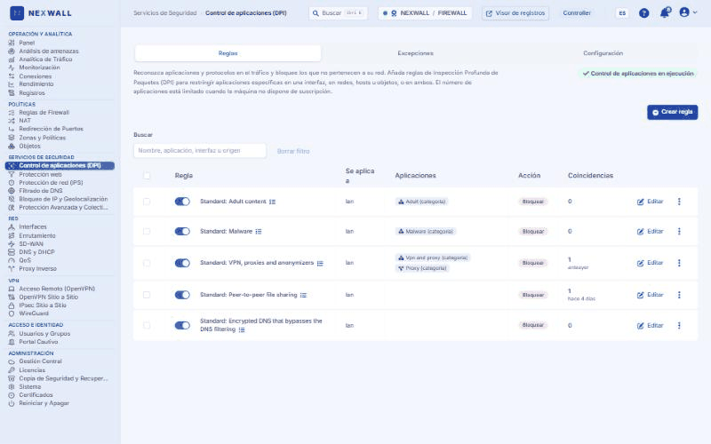

# Cómo bloquear aplicaciones y protocolos (Control de aplicaciones)

El control de aplicaciones identifica aplicaciones mediante inspección profunda de paquetes (DPI) y bloquea las que elija, aunque usen puertos comunes.

**Dónde:** **Servicios de Seguridad** > **Control de aplicaciones (DPI)**

## Antes de empezar

- Una suscripción activa para el catálogo completo de aplicaciones (la página marca los elementos como **Disponible con suscripción**).
- Conozca la interfaz o red a la que se aplica la regla.

## Pasos

1. Abra la página. En la pestaña **Reglas** haga clic en **Crear regla**.

   

2. Elija la **Interfaz** (**Cualquier interfaz** o una) y, en **Se aplica a**, añada las redes, hosts u objetos. Vacío significa **Todos los hosts de la interfaz**.
3. En **Aplicaciones y protocolos que bloquear** busque por nombre o categoría y seleccione cada app o protocolo a bloquear. El contador indica cuántos hay seleccionados.
4. Active **Activar regla** y haga clic en **Guardar regla**.
5. Para que un host omita las reglas abra la pestaña **Excepciones**, haga clic en **Añadir excepción**, introduzca el **Nombre de la excepción** y la **Dirección IP**.

## Compruebe que funciona

- La regla muestra **Aplicaciones y protocolos bloqueados**. Pruebe la app desde un cliente: falla. Las conexiones bloqueadas aparecen en **Registros** y **Análisis de amenazas**.

## Si no funciona

- Una app no se bloquea: puede usar una versión nueva cifrada. Actualice el catálogo (**Ajustes**) y vea [KBA-0022](../../help/kba-22-unknown-applications.md).
- Lentitud no deseada: [KBA-0019](../../help/kba-19-inspection-settings.md) y [KBA-0021](../../help/kba-21-dpi-engine-stall.md).

## Guías relacionadas

- [Cómo filtrar sitios web por categoría (Protección web)](web-protection.md)
- [Cómo activar la prevención de intrusiones (IPS)](ips.md)
