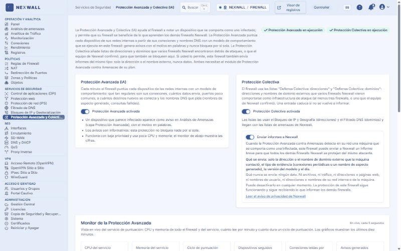

# Cómo activar la Protección avanzada y colectiva

La protección avanzada (IA) avisa de dispositivos que se comportan como infectados. La protección colectiva añade listas de direcciones y dominios aprendidas de otros firewalls Nexwall.

**Dónde:** **Servicios de Seguridad** > **Protección Avanzada y Colectiva (IA)**

## Antes de empezar

- Un plan que incluya el módulo Advanced Threat Protection (vea [Cómo registrar la licencia y revisar la suscripción](../admin/licensing.md)).

## Pasos

1. Abra la página.

   

2. En **Protección Avanzada (IA)** active **Protección Avanzada activada**. La protección solo avisa en **Análisis de amenazas**; no bloquea nada por sí sola.
3. En **Protección Colectiva** active **Protección Colectiva activada**. Las listas compartidas las usan Bloqueo de IP y Filtrado de DNS, por lo que ambos deben estar activos ([Cómo bloquear direcciones IP y países maliciosos (Bloqueo de IP y Geolocalización)](ip-geo-blocking.md), [Cómo bloquear dominios maliciosos (Filtrado de DNS)](dns-filtering.md)).
4. Decida sobre **Enviar informes a Nexwall**. Solo se envía la dirección o el nombre de dominio externos; ningún archivo, tráfico ni dato de usuario.
5. Guarde y aplique. El **Monitor de la Protección Avanzada** muestra la CPU y memoria del servicio y las alertas generadas.

## Compruebe que funciona

- El monitor muestra el ciclo de puntuación en marcha y el número de dispositivos seguidos.

## Si no funciona

- "No incluido en su plan": revise **Licencias**.
- Servicio detenido: reinícielo desde la consola y vea [KBA-16](../../help/kba-16-services.md).

## Guías relacionadas

- [Cómo bloquear direcciones IP y países maliciosos (Bloqueo de IP y Geolocalización)](ip-geo-blocking.md)
- [Cómo revisar las amenazas detenidas y los dispositivos en riesgo](../monitor/threat-analytics.md)
