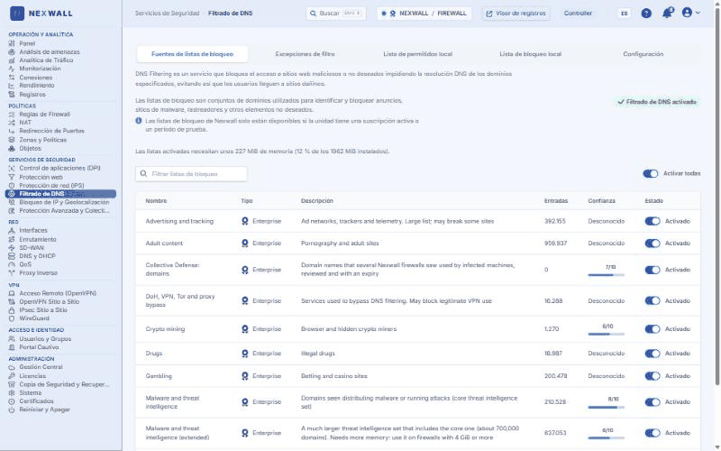

# Cómo bloquear dominios maliciosos (Filtrado de DNS)

El filtrado de DNS impide que los clientes resuelvan dominios maliciosos conocidos usando listas de bloqueo que se actualizan automáticamente.

**Dónde:** **Servicios de Seguridad** > **Filtrado de DNS**

## Antes de empezar

- Los clientes usan el firewall como servidor DNS ([Cómo activar y ajustar el servidor DHCP](../network/dhcp-server.md)).

## Pasos

1. Abra la página y elija la pestaña **Configuración**.

   

2. Active **Filtrado de DNS activado**. Elija las **Forzar la redirección de DNS en estas zonas** donde las peticiones DNS deben redirigirse al firewall, aunque el cliente tenga su propio DNS.
3. En la pestaña **Fuentes de listas de bloqueo** active las listas que desee. Atienda al aviso de memoria: las listas grandes la necesitan.
4. Para bloquear un dominio más abra **Lista de bloqueo local** y haga clic en **Añadir dominio**. Para permitir siempre un dominio use **Lista de permitidos local**.
5. Para exceptuar un cliente use **Excepciones de filtro** y **Añadir excepción**.

## Compruebe que funciona

- `nslookup` de un dominio bloqueado no devuelve la dirección real. Los bloqueos aparecen en **Análisis de amenazas**.

## Si no funciona

- Un sitio bueno está bloqueado: añada su dominio a la lista local de permitidos.
- Las listas no cargan: [KBA-23](../../help/kba-23-threat-shield-troubleshooting.md) y [KBA-24](../../help/kba-24-threat-shield-lists.md).

## Guías relacionadas

- [Cómo bloquear direcciones IP y países maliciosos (Bloqueo de IP y Geolocalización)](ip-geo-blocking.md)
- [Cómo definir servidores DNS y nombres DNS locales](../network/dns-record.md)
