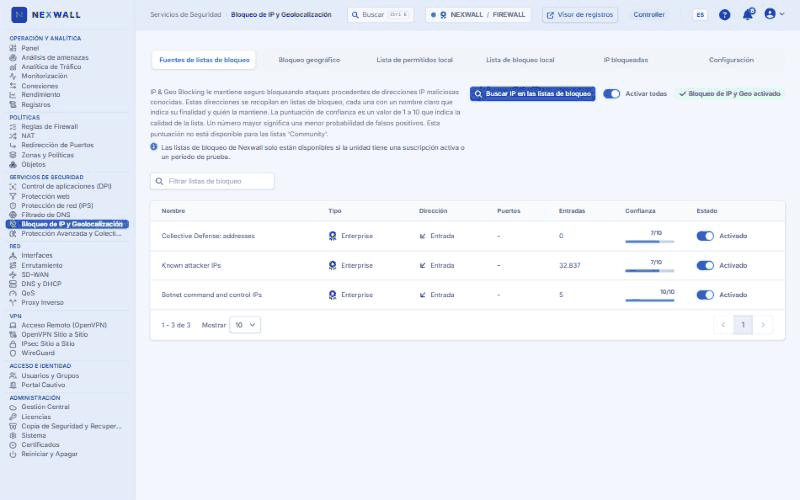

# Cómo bloquear direcciones IP y países maliciosos (Bloqueo de IP y Geolocalización)

El bloqueo de IP y geolocalización descarta el tráfico desde y hacia direcciones con mala reputación, por lista o por país, antes de que llegue a sus reglas.

**Dónde:** **Servicios de Seguridad** > **Bloqueo de IP y Geolocalización**

## Pasos

1. Abra la página y elija la pestaña **Configuración**.

   

2. Active **Bloqueo de IP y Geo activado**. Defina las opciones: **Registro** de paquetes bloqueados y **Bloquear ataques de fuerza bruta**.
3. En la pestaña **Fuentes de listas de bloqueo** active las listas que desee. Cada lista muestra su **Dirección** y **Confianza**.
4. Para impedir que países enteros lleguen al propio firewall abra la pestaña **Bloqueo geográfico** y marque los **Países bloqueados**. Las direcciones expulsadas (fuerza bruta) aparecen en **IP bloqueadas**.
5. Para bloquear una dirección abra **Lista de bloqueo local** y haga clic en **Añadir dirección**. Para proteger la dirección de un socio use **Lista de permitidos local**.
6. Guarde y aplique.

## Compruebe que funciona

- Los paquetes bloqueados se cuentan y, con el registro activado, se escriben en el log.

## Si no funciona

- Un socio no puede conectar: añada su dirección a la lista local de permitidos.
- Las listas no se actualizan: [KBA-24](../../help/kba-24-threat-shield-lists.md).

## Guías relacionadas

- [Cómo bloquear dominios maliciosos (Filtrado de DNS)](dns-filtering.md)
- [Cómo permitir o bloquear tráfico con una regla de firewall](../policy/firewall-rule.md)
