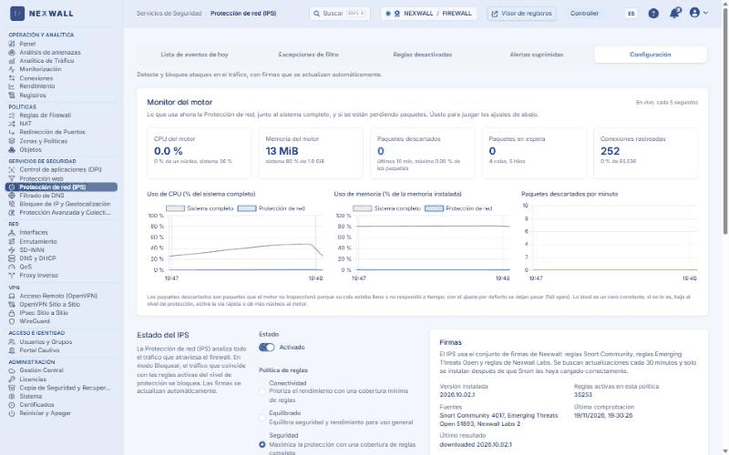

# Cómo activar la prevención de intrusiones (IPS)

El IPS inspecciona el tráfico en busca de ataques. Empiece con la política equilibrada y súbala solo si lo necesita.

**Dónde:** **Servicios de Seguridad** > **Protección de red (IPS)**

## Antes de empezar

- Una suscripción activa (la página informa si falta la licencia).
- Memoria suficiente: vea [KBA-20](../../help/kba-20-throughput-sizing.md).

## Pasos

1. Abra la página y elija la pestaña **Configuración**.

   

2. Active **IPS activado**. Si la página muestra **El IPS está desactivado**, use **Ir a Configuración**.
3. Elija la **Política de reglas**: **Conectividad** (menos falsos positivos), **Equilibrado** (recomendada) o **Seguridad** (la más estricta).
4. Compruebe que las firmas están actualizadas en **Firmas**; haga clic en **Buscar actualizaciones ahora** si hace falta.
5. Guarde y aplique. Para una dirección de confianza que genera falsas alarmas abra la pestaña **Excepciones de filtro** y haga clic en **Añadir excepción**.

## Compruebe que funciona

- La pestaña **Lista de eventos de hoy** lista los eventos del día. El estado del IPS indica que funciona.

## Si no funciona

- Bajó el rendimiento: [KBA-19](../../help/kba-19-inspection-settings.md) y [KBA-20](../../help/kba-20-throughput-sizing.md).
- Un servicio legítimo bloqueado: busque la regla en la lista de eventos y use **Reglas desactivadas** o la exclusión.

## Guías relacionadas

- [Cómo bloquear aplicaciones y protocolos (Control de aplicaciones)](app-control.md)
- [Cómo revisar las amenazas detenidas y los dispositivos en riesgo](../monitor/threat-analytics.md)
