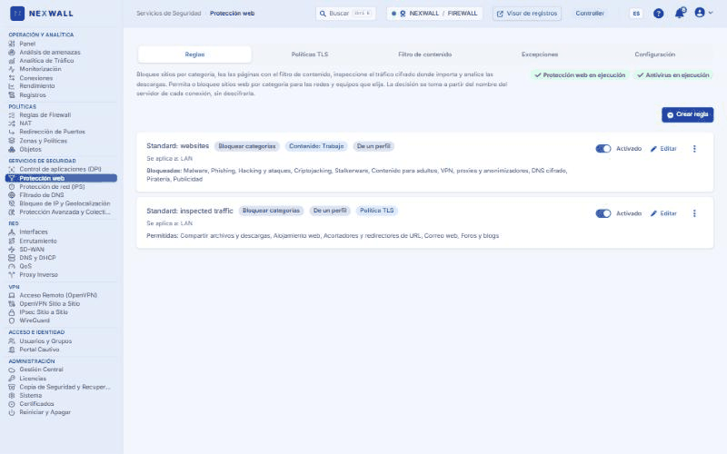

# Cómo filtrar sitios web por categoría (Protección web)

La protección web filtra HTTP y HTTPS por categoría. Con inspección SSL las categorías se aplican a páginas cifradas; sin ella solo se usa el nombre de host.

**Dónde:** **Servicios de Seguridad** > **Protección web**

## Antes de empezar

- Una suscripción que incluya Protección web.
- Para el filtrado HTTPS completo, el certificado del firewall instalado en los clientes ([Cómo instalar un certificado web de confianza (Let's Encrypt o importado)](../admin/certificate.md)).

## Pasos

1. Abra la página y, en la pestaña **Configuración**, active **Activar la protección web** si está desactivado.

   

2. Vaya a la pestaña **Reglas** y haga clic en **Crear regla**.
3. Escriba el **Nombre de la regla** y elija las **Zonas** y, opcionalmente, los **Redes, equipos y objetos** (redes, hosts y objetos).
4. Elija el modo: **Bloquear categorías** (bloquea las categorías que marque) o **Lista de permitidos** (solo se permiten las categorías marcadas).
5. Marque cada categoría como **Permitidas** o **Bloqueadas**. Use **Buscar categorías** para encontrarlas. Elija la **Política TLS** y active **Activar la regla**. Guarde.
6. Para exceptuar un host o sitio use la pestaña **Excepciones**.

## Compruebe que funciona

- Una categoría bloqueada muestra la página de bloqueo en el navegador.
- La regla aparece en la lista; el catálogo de categorías está al día en **Listas de categorías**.

## Si no funciona

- Aviso de certificado en sitios HTTPS: instale la CA del firewall en el cliente o exceptúe el sitio.
- Un sitio está mal categorizado: añada una excepción e infórmelo a Nexwall.

## Guías relacionadas

- [Cómo bloquear dominios maliciosos (Filtrado de DNS)](dns-filtering.md)
- [Cómo bloquear aplicaciones y protocolos (Control de aplicaciones)](app-control.md)
