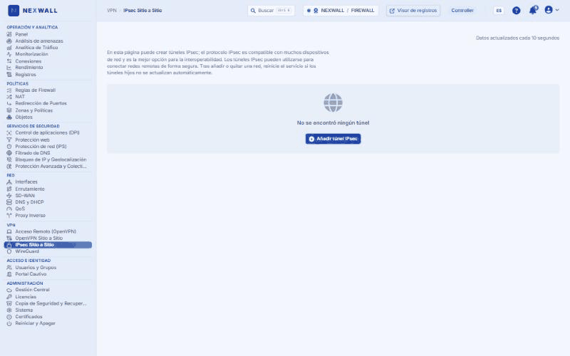

# Cómo crear un túnel IPsec con otro firewall o router

IPsec (IKEv2) es la opción estándar para conectar con un router o firewall de otra marca.

**Dónde:** **VPN** > **IPsec Sitio a Sitio**

## Antes de empezar

- La dirección pública del otro extremo y su identificador (si lo hay).
- Las redes remota y local, que no deben solaparse, y la misma clave precompartida y parámetros de cifrado en ambos extremos.

## Pasos

1. Abra la página y haga clic en **Añadir túnel IPsec**.

   

2. Escriba el **Nombre del túnel**. Elija la WAN con **Elegir WAN** e introduzca la **Dirección IP remota**.
3. Añada las **Redes locales** y **Redes remotas** con **Añadir red**.
4. En **Clave precompartida** use **Usar clave generada** (cópiela al otro extremo) o **Usar clave personalizada**. Defina el identificador local y remoto solo si el otro lado lo exige.
5. Abra **Fase 1 (IKE)** y la sección de fase 2 y haga coincidir los algoritmos, tiempos de vida y DPD del otro extremo. Guarde.
6. Cree las reglas de firewall entre las zonas LAN y VPN ([Cómo permitir o bloquear tráfico con una regla de firewall](../policy/firewall-rule.md)) y excluya del NAT el tráfico del túnel ([Cómo crear una regla de NAT (enmascaramiento o NAT de origen)](../policy/nat-rule.md)).

## Compruebe que funciona

- La fila del túnel muestra **Conectado**, con el child SA **Instalado**. En la consola, `swanctl --list-sas` muestra ESTABLISHED.

## Si no funciona

- Nunca sale del estado conectando: clave, identificadores o propuestas incorrectos. Compare ambos extremos y revise el log: `grep charon /var/log/messages`.
- Activo sin tráfico: reglas, NAT o rutas. Vea [KBA-06](../../help/kba-06-vpn.md).

## Guías relacionadas

- [Cómo conectar dos oficinas con OpenVPN (sitio a sitio)](openvpn-site-to-site.md)
- [Cómo crear una regla de NAT (enmascaramiento o NAT de origen)](../policy/nat-rule.md)
