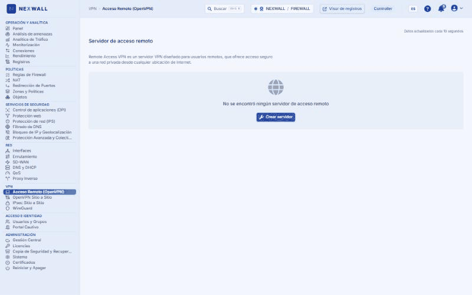

# Cómo permitir que los usuarios se conecten desde casa (acceso remoto OpenVPN)

El acceso remoto (OpenVPN) permite a portátiles y móviles conectarse de forma segura a sus redes desde cualquier lugar.

**Dónde:** **VPN** > **Acceso Remoto (OpenVPN)**

## Antes de empezar

- La dirección WAN del firewall o un nombre DNS que apunte a ella ([Cómo instalar un certificado web de confianza (Let's Encrypt o importado)](../admin/certificate.md) si quiere un certificado web de confianza).
- Los usuarios existen en la base local o en un directorio ([Cómo crear usuarios y conectar un directorio (LDAP / Active Directory)](../access/user.md)).
- Una dirección WAN accesible desde internet: el puerto de la VPN (UDP 1194 por defecto) debe llegar al firewall.

## Pasos

1. Abra la página y haga clic en **Crear servidor**.

   

2. Escriba el **Nombre del servidor**. Elija la **Base de datos de usuarios** y el **Modo de autenticación** (**Usuario y contraseña**, **Certificado** o con OTP).
3. Elija el **Modo**: **Enrutado** (recomendado) con una **Red VPN** que no se solape con su LAN, por ejemplo `10.8.0.0/24`.
4. Añada la **IP pública/nombre de host de esta unidad**. Mantenga el **Protocolo** **UDP** y el **Puerto** por defecto salvo que una red lo bloquee.
5. Elija qué alcanzan los clientes: **Enviar rutas de red** (solo las redes que añada) o **Enrutar todo el tráfico de los clientes a través de la VPN**.
6. Haga clic en **Crear**. Luego abra la pestaña **Cuentas de acceso remoto**, cree las cuentas (o **Crear una cuenta para cada usuario**) y use **Descargar configuración** para cada usuario.
7. Entregue al usuario el archivo para importarlo en un cliente OpenVPN.

## Compruebe que funciona

- **Clientes conectados** lista al usuario tras conectarse. El usuario llega a una dirección interna.

## Si no funciona

- El cliente no conecta: el puerto no está abierto en la WAN o un router previo lo bloquea. Pruebe desde fuera de la LAN.
- Conecta pero no llega a la LAN: añada la red en **Enviar rutas de red** y cree una [Cómo permitir o bloquear tráfico con una regla de firewall](../policy/firewall-rule.md) desde la zona VPN.
- Vea [KBA-06](../../help/kba-06-vpn.md).

## Guías relacionadas

- [Cómo crear usuarios y conectar un directorio (LDAP / Active Directory)](../access/user.md)
- [Cómo configurar WireGuard (servidor con pares o túnel de par)](wireguard.md)
- [Cómo permitir o bloquear tráfico con una regla de firewall](../policy/firewall-rule.md)
