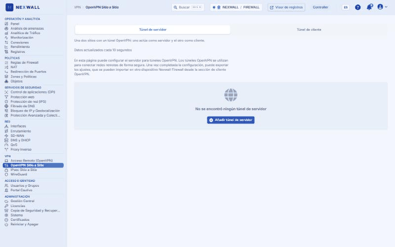

# Cómo conectar dos oficinas con OpenVPN (sitio a sitio)

Un firewall actúa como servidor del túnel y el otro como cliente. El servidor exporta un paquete que el cliente importa.

**Dónde:** **VPN** > **OpenVPN Sitio a Sitio**

## Antes de empezar

- Una dirección pública (o nombre) accesible en el lado servidor.
- Las redes local y remota no deben solaparse.

## Pasos

1. En el sitio servidor abra la página, pestaña **Túnel de servidor**, y haga clic en **Añadir túnel de servidor**.

   

2. Escriba el **Nombre del túnel**. Añada las **Redes locales** a compartir y las **Redes remotas** del otro sitio. Añada los **Endpoints públicos** (dirección pública o nombre).
3. Mantenga el **Protocolo** y el **Puerto** por defecto. Haga clic en **Guardar**.
4. Haga clic en **Descargar** en la fila del túnel y elija el archivo de **Configuración de cliente \{product\}**.
5. En el otro sitio abra la pestaña **Túnel de cliente**, haga clic en **Importar configuración** y elija el archivo. Guarde.
6. En ambos firewalls cree una [Cómo permitir o bloquear tráfico con una regla de firewall](../policy/firewall-rule.md) entre la zona LAN y la zona VPN y asegúrese de que el NAT no traduce el tráfico del túnel ([Cómo crear una regla de NAT (enmascaramiento o NAT de origen)](../policy/nat-rule.md)).

## Compruebe que funciona

- Ambos lados muestran la conexión como **Conectado**. Un host de una LAN hace ping a un host de la otra.

## Si no funciona

- No conectado: el puerto UDP no es accesible en el servidor. Pruebe desde fuera.
- Conectado, sin tráfico: falta una regla de firewall, redes solapadas o falta una ruta en los hosts.
- Vea [KBA-0006](../../help/kba-06-vpn.md).

## Guías relacionadas

- [Cómo crear un túnel IPsec con otro firewall o router](ipsec-site-to-site.md)
- [Cómo configurar WireGuard (servidor con pares o túnel de par)](wireguard.md)
