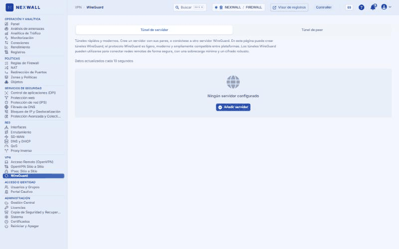

# Cómo configurar WireGuard (servidor con pares o túnel de par)

WireGuard es rápido y sencillo. Un túnel servidor atiende a muchos pares; un túnel de par conecta este firewall con otro servidor WireGuard.

**Dónde:** **VPN** > **WireGuard**

## Pasos

1. Abra la página. Para usuarios elija la pestaña **Túnel de servidor** y haga clic en **Añadir servidor**.

   

2. Escriba el **Nombre**, la **Red VPN** (por ejemplo `10.9.0.0/24`), el **Puerto UDP** y el **Endpoint público** del firewall. Añada las **Redes del servidor** que los pares pueden alcanzar y, si hace falta, los **Servidores DNS**. Guarde.
3. En la fila del servidor haga clic en **Añadir peer**: escriba el **Nombre** del par, elija **Enrutar todo el tráfico** si todo el tráfico debe ir por la VPN y guarde.
4. Entregue al par la configuración: **Descargar configuración** o **Descargar código QR** para escanear con la app del móvil.
5. Para conectar este firewall con otro servidor WireGuard use la pestaña **Túnel de peer**: **Añadir túnel de peer** o **Importar túnel de peer** con un archivo de configuración.
6. Cree las reglas de firewall entre las zonas ([Cómo permitir o bloquear tráfico con una regla de firewall](../policy/firewall-rule.md)).

## Compruebe que funciona

- El par muestra un handshake reciente (**Conexión**). Desde el par, haga ping a una dirección interna.

## Si no funciona

- Sin handshake: el puerto UDP no es accesible o las claves no coinciden.
- Handshake pero sin tráfico: reglas o las redes permitidas del par.
- Vea [KBA-0006](../../help/kba-06-vpn.md).

## Guías relacionadas

- [Cómo permitir que los usuarios se conecten desde casa (acceso remoto OpenVPN)](openvpn-remote-access.md)
- [Cómo permitir o bloquear tráfico con una regla de firewall](../policy/firewall-rule.md)
