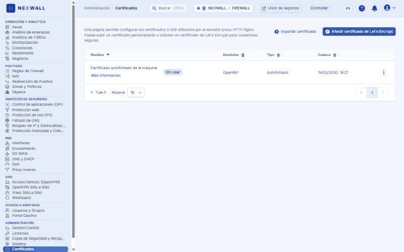

# Certificados

**Administración > Certificados** gestiona los certificados X.509 que usa el servidor web de la unidad. Esto abarca la
interfaz web y el [proxy inverso](../network/reverse-proxy.md).

*Certificados: el certificado de la máquina y los botones para importar o solicitar uno.*

**En esta pantalla**

- La lista muestra cada certificado con sus dominios, tipo y fecha de caducidad. **Sin usar** significa que ningún servicio lo usa todavía.
- **Importar certificado** sube el suyo; **Añadir certificado de Let's Encrypt** solicita uno gratuito para un nombre público.
- La primera fila es el certificado autofirmado que el firewall crea para sí mismo.

## El certificado predeterminado

Una unidad nueva usa un certificado autofirmado, en el que los navegadores no confían. Puede seguir usándolo dentro de una
red pequeña, pero para cualquier otra cosa, reemplácelo.

## Obtener un certificado

| Método | Cuándo usarlo |
|---|---|
| Cargar | Ya tiene un certificado, su clave privada y su cadena de una autoridad certificadora |
| Let's Encrypt | Quiere un certificado gratuito que se renueve solo |

### Let's Encrypt

La unidad solicita un certificado para uno o más nombres y lo renueva antes de que caduque. El nombre debe resolverse a la
unidad, y uno de los dos métodos de validación debe funcionar:

- **Standalone (HTTP):** la autoridad se conecta a la unidad en el puerto 80. El puerto 80 debe ser accesible desde
  internet.
- **DNS:** la unidad demuestra la propiedad creando un registro en su zona DNS. No necesita ningún puerto de entrada y puede
  emitir certificados **wildcard**. Elija su proveedor de DNS e introduzca los datos de acceso que requiere.

## Usar un certificado

Marque un certificado como el **predeterminado**. Se sirve cuando alguien accede a la unidad por su nombre de dominio
completo. Los demás certificados se seleccionan en las reglas del proxy inverso.

## Eliminar

Eliminar un certificado es irreversible. Asegúrese antes de que nada lo usa.

## Páginas relacionadas

- [Proxy inverso](../network/reverse-proxy.md)
- [Sistema](system.md)
