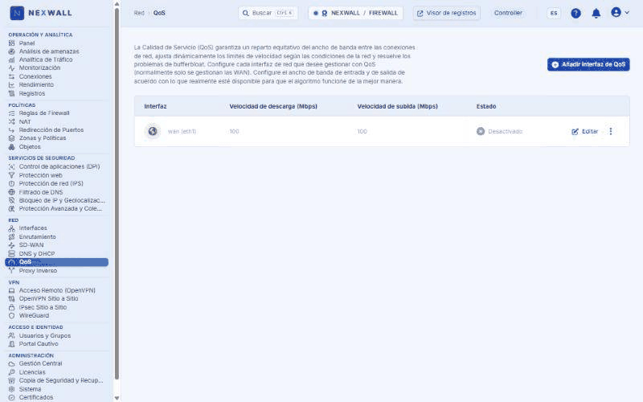

# Calidad de servicio (QoS)

**Red > QoS** mantiene su enlace de internet con buena respuesta cuando está ocupado. La unidad reparte el ancho de banda
disponible de forma equitativa entre las conexiones, ajusta los límites según las condiciones de la red y reduce el
**bufferbloat**: el retardo que aparece cuando un enlace saturado pone en cola demasiados paquetes.

*QoS: elija las interfaces a gestionar y el ancho de banda real de cada una.*

**En esta pantalla**

- Cada fila es una interfaz (normalmente una WAN) con su velocidad de **descarga** y **subida** en Mbps.
- Introduzca la velocidad que su proveedor entrega de verdad; un poco por debajo del contrato es lo más seguro.
- **Añadir interfaz de QoS** agrega otro enlace; **Editar** activa o desactiva QoS en una fila.

## Configurar una interfaz

El QoS se configura para cada interfaz WAN.

1. Mida la velocidad real del enlace con una prueba de velocidad, en ambos sentidos.
2. Habilite el QoS para la interfaz.
3. Introduzca la velocidad de **descarga** (entrante) y la de **subida** (saliente), en Mbit por segundo.
4. Guarde y **Aplicar cambios**.

:::tip Introduzca un poco menos que la medición
Introduzca un valor de un 5 a un 10 por ciento por debajo de lo que midió. Así queda margen para que la cola permanezca en
la unidad, donde se puede gestionar, y no en su proveedor.
:::

## Cuándo usarlo

- Las videollamadas o la voz se entrecortan mientras alguien descarga un archivo grande.
- Las páginas web cargan despacio cuando el enlace está saturado.
- Comparte un enlace entre muchos usuarios y quiere equidad.

## Páginas relacionadas

- [SD-WAN](sd-wan.md)
- [Rendimiento](../operation-analytics/performance.md)
